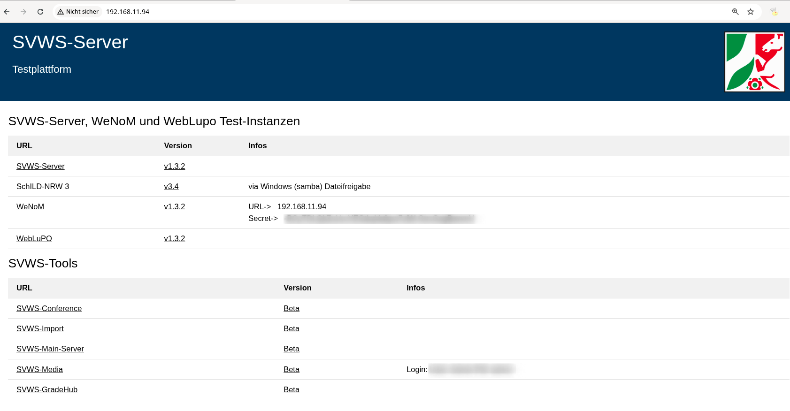

# Installationsskripte gezielt auswählen

## Vor dem Start: Was soll auf welchem Rechner entstehen?

Die Skripte sind **Werkzeuge für vorbereitete Testsysteme**, keine universelle Installation für jeden Raum. Auf einem Windows-Arbeitsplatz führst Du diese Bash-Dateien nicht als Windows-Installer aus. Ein Proxmox-Host, eine Debian-VM und ein Docker-Container sind unterschiedliche Ausführungsorte.

| Aufgabe | Richtiger Weg |
| --- | --- |
| Einen zentralen Docker-Schulungsserver bereitstellen | [Docker-Anleitung](../Docker_Schulungsserver/index.md): Engine installieren, Projekt vorbereiten, starten, Daten getrennt importieren |
| SVWS direkt auf einer frischen Debian-VM installieren | [Linux-Installer](#linux-installer) mit ausgewähltem offiziellem Release |
| Eine Übungsdatenbank bereitstellen oder zurücksetzen | AdminClient; für einen kontrollierten Einzelimport die folgenden Werkzeuge |
| Proxmox-Container anlegen oder bedienen | [Proxmox-Anleitung](../Proxmox_Schulungsserver/index.md); nur auf dem PVE-Host |
| Viele Anwendungen aus Entwicklungsquellen bauen | Kein Standardweg; experimentelle Helfer sind für den normalen Aufruf gesperrt |

Die frühere Aussage „alle Skripte unter Debian 13 getestet“ war für diesen Bestand nicht mit einem vollständigen Nachweis hinterlegt. Hier werden **Syntaxprüfung, simulierte Funktionstests und echte Diensteproben getrennt** dokumentiert. Ein erfolgreicher Syntaxcheck installiert kein System und bestätigt keine Hardwareeignung.

## Skripte beziehen und prüfen

Du benötigst Bash und die jeweils verwendeten Werkzeuge. Der Downloader setzt `curl` und `jq` voraus und installiert keine Pakete selbst:

```bash
bash download_all_scripts.sh ./fbm-installationsskripte
```

Der [Downloader](./download_all_scripts.sh) lädt Dateien dieser Sammlung aus `Raffenberg/SVWS_FBM`, standardmäßig aus `dev`, in einen **neuen** Ordner. Für einen reproduzierbaren Stand kann `FBM_REF` auf einen zuvor geprüften Commit gesetzt werden. Ein Download ist keine Freigabe zum Ausführen jedes enthaltenen Skripts.

Docker- und Proxmox-Werkzeuge liegen in eigenen Geschwisterordnern. Erhalte bei einem vollständigen Checkout die Verzeichnisstruktur; mehrere Wrapper benötigen die Datei aus `../Installationsskripte/`.

## Linux-Installer {#linux-installer}

[install_svws_testserver_linuxinstaller.sh](./install_svws_testserver_linuxinstaller.sh) lädt das **offizielle SVWS-Release-Skript** in einen neuen Arbeitsordner und bereitet eine geschützte `.env` vor. Es ist für eine frische Debian-Test-VM vorgesehen, nicht für den Proxmox-Host oder für die Reparatur einer bestehenden Installation.

```bash
bash install_svws_testserver_linuxinstaller.sh -v 1.4.1 -p EIN_EIGENES_LANGES_PASSWORT --prepare-only
```

Prüfe danach Skript und Einstellungen. Ohne `--prepare-only` wird der offizielle Installer mit Root-Rechten ausgeführt. Beide Parameter `-v` und `-p` sind Pflicht. Der Passwortwert muss mindestens zwölf Zeichen aus Buchstaben, Ziffern, `_` und `-` enthalten; diese Einschränkung vermeidet Mehrdeutigkeiten beim Einlesen der erzeugten Umgebung durch den Upstream-Installer.

Die **tatsächliche Installation und Paketwahl** bestimmt das jeweilige Release. Die Vorbereitungsprüfung ersetzt deshalb keine Installation auf der vorgesehenen VM. Für Updates einer bestehenden Installation gilt der [offizielle Linux-Updateweg](https://doku.svws-nrw.de/deployment/Linux-Installer/#update) mit der ursprünglichen Konfiguration.

## Eine SQLite-Datei gezielt importieren

Bevorzuge für die normale Moderation den AdminClient. Der Skriptweg [create_svws_testdbs.sh](./create_svws_testdbs.sh) benötigt eine lokale, echte SQLite-Datei und ein ausdrücklich gewähltes Zielschema. Er lädt nicht mehr stillschweigend ein ganzes Entwicklerdatenbank-Repository.

```bash
read -r -s -p "MariaDB-Root-Passwort: " SVWS_ROOT_PASSWORD; echo
read -r -s -p "Neues Schema-Passwort: " SVWS_SCHEMA_PASSWORD; echo
export SVWS_ROOT_PASSWORD SVWS_SCHEMA_PASSWORD
bash create_svws_testdbs.sh -f ./uebung.sqlite -n platz01 -u platz01 -s SERVERADRESSE -P 8443
unset SVWS_ROOT_PASSWORD SVWS_SCHEMA_PASSWORD
```

Ersetze `SERVERADRESSE` durch das Zielsystem. Die Zertifikatsprüfung bleibt standardmäßig aktiv. `--insecure` ist nur eine bewusst gewählte Ausnahme für eine bereits identifizierte isolierte Testinstanz mit selbstsigniertem Zertifikat. Es wird nicht als allgemeiner Standard vorausgesetzt.

Ein Transport-/HTTP-Fehler bricht den Aufruf ab. Prüfe danach Schema, Datenstand und Anmeldung fachlich im AdminClient. Wiederholtes Importieren in ein bereits belegtes Schema ist kein nachgewiesener Resetweg.

[docker_multimport_sqlite.sh](../Docker_Schulungsserver/docker_multimport_sqlite.sh) ist trotz des historischen Namens jetzt ein **Einzelimport-Wrapper**. Er benötigt die lokale Datei, den Schemanamen und den ausdrücklich gewählten Schema-Benutzer und einen laufenden Container mit veröffentlichtem IPv4-HTTPS-Port. Er installiert keine zusätzlichen Werkzeuge im Container.

## Ein einzelnes Schema entfernen

[delete_all_svws_dbs.sh](./delete_all_svws_dbs.sh) löscht nicht mehr automatisch alle Datenbanken. Der Dateiname bleibt aus Kompatibilitätsgründen erhalten.

```bash
bash delete_all_svws_dbs.sh --schema platz01 -s SERVERADRESSE -P 8443
```

Dies ist nur eine Vorschau. Die echte Aktion braucht zusätzlich `--execute --confirm-server SERVERADRESSE` und die gesetzte Variable `SVWS_ROOT_PASSWORD`. Sichere vorher nötige Ergebnisse und kontrolliere die Zuordnung des Arbeitsplatzes. Nutze anschließend den vereinbarten Wiederherstellungsweg.

## Zusatzanwendungen und experimentelle Aufbauten

WeNoM und WebLuPO sind gesonderte Anwendungen. Apache-/PHP-Konfiguration, DNS, Zertifikate und die Kopplung an das richtige Schema sind zusätzliche Aufgaben. Eine korrekt entpackte ZIP-Datei bestätigt noch keine funktionierende Notenübertragung.

Der frühere All-in-one-Aufbau mischt Docker, Samba, Apache, nginx und Builds aus Entwicklungsquellen. Er ist deshalb **keine wartungsarme Empfehlung**. Das gilt ebenso für Quellenbuilds, automatisches `wipe`, ungeprüfte Passwortmigration und Mehrfach-WeNoM.

Fünf entsprechende Bestandsskripte brechen beim normalen Aufruf mit Exitcode 78 ab. Für eine gesonderte Entwicklungskopie kann ein fachkundiger Bearbeiter mit `FBM_EXPERIMENTAL=1` weiter am Code arbeiten; das ist ausdrücklich keine Integrationsfreigabe.

::: details Abbildung des früheren All-in-one-Beispiels
Die Grafik dokumentiert den früheren Funktionsumfang, nicht einen aktuell freigegebenen Installationsweg.


:::

## Prüfbericht {#pruefbericht}

Prüfstand: **25.10.2026**. Bestand: **27 Shell-Dateien**. Die Tabelle nennt beobachtete Mängel und die vorgenommenen Korrekturen bzw. Grenzen. Die Laufzeitergebnisse der CI stehen im zugehörigen Pull Request und in den Prüfarbeitsdateien.

| Skript | Vorheriger Befund | Änderung / Einordnung | Nachweisgrenze |
| --- | --- | --- | --- |
| [install_docker.sh](../Docker_Schulungsserver/install_docker.sh) | Falscher Shebang; Nebenwirkungen durch allgemeines Systemupdate. | Shebang, Debian-/Konfliktprüfung; nur Docker/Compose, kein pauschales Upgrade. | Syntax; Hilfe; echter Host-Installer nicht ausgeführt |
| [docker_create_svws.sh](../Docker_Schulungsserver/docker_create_svws.sh) | Überschreibbare Ordner, latest-DB, unpassende Namen und Passwortausgaben. | Neue Ordner, feste Versionseingaben, localhost-Standard, optionaler DB-Port, geschützte .env; MariaDB-Host für den Gesundheitscheck dienstbezogen. | Parameter-/Dateitests; Compose-/Containerprobe |
| [install_svws_testserver_docker.sh](../Docker_Schulungsserver/install_svws_testserver_docker.sh) | Doppelter Installer, sofortiger Import ohne Bereitschaftsprüfung, eval. | Kompatibilitätsaufruf des Projektgenerators; kein stiller Import. | Hilfe; Generatorprobe |
| [docker_multimport_sqlite.sh](../Docker_Schulungsserver/docker_multimport_sqlite.sh) | Ausführbare Trennzeile ---; externer Testserver-Pfad nicht mehr vorhanden. | Lokaler Einzelimport über veröffentlichten Port; kein Nachinstallieren im Container. | Fehlerpfade; Schnittstellen-Simulation |
| [clone_db_in_docker_container.sh](../Docker_Schulungsserver/clone_db_in_docker_container.sh) | Abweichender App-Containername; Import in bestehende Schemata. | Name angeglichen, Namen/Anzahl geprüft, temporärer Dump; vorhandene DB wird nicht erweitert. | Syntax; kein realer SQL-Klon-/Neustartnachweis |
| [delete_all_docker_container.sh](../Docker_Schulungsserver/delete_all_docker_container.sh) | Stoppt/löscht global alle Container. | Nur gekennzeichnetes Projekt; Vorschau, kein Entfernen von Datenordnern. | Eingrenzung und Fehlerabbrüche simuliert |
| [docker_rm_all_container.sh](../Docker_Schulungsserver/docker_rm_all_container.sh) | Zweiter globaler Löschhelfer mit gleichem Risiko. | Wie projektbezogener Löschhelfer; historischer Dateiname bleibt. | Eingrenzung und Fehlerabbrüche simuliert |
| [download_all_scripts.sh](../Installationsskripte/download_all_scripts.sh) | Altes Repositoryverzeichnis und unnötiges apt upgrade. | Richtiges Repository/Ref, HTTP-Fehlerprüfung; neuer Zielordner, keine Paketinstallation. | Download-Fehlerfälle simuliert |
| [install_svws_testserver_linuxinstaller.sh](../Installationsskripte/install_svws_testserver_linuxinstaller.sh) | Falsche Beschreibung; Passwort entgegen dem Text Pflicht; vorhandene .env überschreibbar. | Eigenes Arbeitsverzeichnis, Version/Passwortpflicht, Download-/Syntaxprüfung, prepare-only. | Vorbereitung simuliert; offizielles 1.4.1-Skript separat gelesen |
| [create_svws_testdbs.sh](../Installationsskripte/create_svws_testdbs.sh) | Unklarer Arbeitsordner, impliziter Massenimport, Passwortausgabe, HTTP-Fehler als Erfolg. | Genau eine SQLite-Datei und ein Schema; keine stillen Downloads; HTTP-Abbruch. | Anfragen und HTTP-Fehler simuliert |
| [delete_all_svws_dbs.sh](../Installationsskripte/delete_all_svws_dbs.sh) | Pauschales Löschen; Antwort-/Fehlerbehandlung unvollständig. | Explizites einzelnes Schema, Vorschau, Zielbestätigung und HTTP-Abbruch. | Nichtausführung ohne Ziel; Anfrage-/Fehlerfälle simuliert |
| [clone_db.sh](../Installationsskripte/clone_db.sh) | Installer-Konfigurationspfad fehlt; bestehende Schemata werden befüllt. | Pfad ergänzt, Eingaben begrenzt, geschützter temporärer Dump, Abbruch bei vorhandener DB. | Syntax; echter SQL-Klon nicht nachgestellt |
| [install_wenom_testserver.sh](../Installationsskripte/install_wenom_testserver.sh) | wget fehlt; uninitialisiertes USEIP; weltbeschreibbarer DB-Ordner. | Abhängigkeit und Default ergänzt; eingeschränkte DB-Ordnerrechte. | Syntax; Apache/PHP/WeNoM-Kopplung noch real zu prüfen |
| [install_weblupo_testserver.sh](../Installationsskripte/install_weblupo_testserver.sh) | wget fehlt; akzeptiert -d ohne passende Verarbeitung. | Abhängigkeit ergänzt; ungenutzte Option wird abgewiesen. | Syntax; keine komplette Apache-Installation |
| [update_wenom_testserver.sh](../Installationsskripte/update_wenom_testserver.sh) | Löscht den Bestand vor dem Download; Sicherung nur auskommentiert. | Version und Neuaufbau (-r) ausdrücklich wählen; Sicherung und Paketprüfung vor der Löschung. | Syntax; destruktiver Neuaufbau, kein übliches datenerhaltendes Update |
| [install_svws_schild3_svws-tools_testserver.sh](../Installationsskripte/install_svws_schild3_svws-tools_testserver.sh) | Falsche Portvariable, Beta-Downloadname, Kopplungsgeheimnis im Web; bewegliche Quellen und Dienstkonflikte. | Konkrete Fehler korrigiert; normaler Aufruf gesperrt (Exit 78). | Syntax; weiterhin experimentell, keine Integrationsfreigabe |
| [install_svws_testserver_fromScratch.sh](../Installationsskripte/install_svws_testserver_fromScratch.sh) | chown ohne Ziel; Entwicklerbuild und Dienstpfade versionsabhängig. | chown-Ziel korrigiert; normaler Aufruf gesperrt (Exit 78). | Syntax; kein freigegebener Schulungsinstaller |
| [update_testserver_from_scratch.sh](../Installationsskripte/update_testserver_from_scratch.sh) | Verwirft Änderungen und führt wipe aus; nicht datenerhaltend belegt. | Normaler Aufruf gesperrt (Exit 78). | Syntax; kein Standard-Updateweg |
| [generate_svws_userpasswords.sh](../Installationsskripte/generate_svws_userpasswords.sh) | Leere Zugangsdaten, direktes Credential-SQL, eval, unvollständige Bereinigung. | eval entfernt, temporäre Datei bereinigt; normaler Aufruf gesperrt (Exit 78). | Syntax; keine Benutzer-/Passwortmigration freigegeben |
| [wenom_to_multiwenom.sh](../Installationsskripte/wenom_to_multiwenom.sh) | Pfade passen nicht zum Installer, 777, DNS-/Zertifikatsannahmen. | Pfade/Rechte angepasst, Konfigurationstest; normaler Aufruf gesperrt (Exit 78). | Syntax; Mehrinstanzbetrieb nicht freigegeben |
| [pve_create_lxc.sh](../Proxmox_Schulungsserver/pve_create_lxc.sh) | /16 fest angehängt; Gateway auch bei DHCP; Passwort in Beschreibung. | CIDR explizit, DHCP ohne Gateway, separate Zugangsdaten; keine ignorierten Entpackfehler. | Parameter und pct-Aufruf simuliert; kein realer PVE-Test |
| [pve_exec_svws_linuxinstaller.sh](../Proxmox_Schulungsserver/pve_exec_svws_linuxinstaller.sh) | Veränderliche Downloads und per Shellstring geschriebene Passwörter. | Lokalen geprüften Wrapper mit pct push übertragen; explizite Parameter. | pct-Simulation; reale LXC-Installation offen |
| [pve_delete_all_svws_dbs.sh](../Proxmox_Schulungsserver/pve_delete_all_svws_dbs.sh) | -nr setzt SNR statt CONTAINER_ID; fremder Download und ungültiger Schlussparameter. | Benannte CT-ID und einzelnes Schema, lokale Datei, Vorschau. | Zielprüfung simuliert; realer PVE-/API-Verbund offen |
| [pve_shutdown_all_LXC.sh](../Proxmox_Schulungsserver/pve_shutdown_all_LXC.sh) | Beendet sämtliche Container mit hartem stop. | Explizite ID-Liste, Prüfung vor Änderung, geordnetes shutdown. | Befehlsauswahl und Fehlerpfade simuliert |
| [clone_lxc.sh](../Proxmox_Schulungsserver/clone_lxc.sh) | Unbegrenzte Anzahl; Klone starten mit ungeprüften Netzadressen. | Anzahl begrenzt, vollständige Klone bleiben bis zur Prüfung ausgeschaltet. | Syntax; Storage-/Netzverhalten real zu prüfen |
| [generate_nginx_reverseproxyentry.sh](../Proxmox_Schulungsserver/generate_nginx_reverseproxyentry.sh) | DNS/TLS/Proxy-Ziel vorausgesetzt, Konfiguration nicht universell passend. | Eingaben vor Konfigurationsschreiben prüfen; nur Expertenwerkzeug. | Syntax; kein fertiger geschützter Fernschulungszugang |
| [install_cert.sh](../Proxmox_Schulungsserver/install_cert.sh) | Kein reiner Zertifikatsinstaller: schreibt nginx-Konfiguration und startet Certbot. | Tatsächlichen Eingriff benennen, Eingaben prüfen; Expertenwerkzeug. | Syntax; reale DNS-/ACME-Prüfung offen |

### Was vor einer Raumfreigabe noch zu prüfen ist

Die Prüfungen laufen nicht auf Deiner Schulungs-Hardware. Eine vollständige Debian-Installation durch den offiziellen Installer, Windows-/SchILD-Installation, Proxmox-/LXC-Betrieb, Apache-/WeNoM-Kopplung und die historische Raumoberfläche sind damit nicht vollständig abgenommen. Installiere zunächst eine eigene Kopie und prüfe die realen Aufgaben einschließlich Wiederherstellung und gleichzeitiger Zugriffe.

Maßgebliche Quellen: [SVWS-Installation](https://doku.svws-nrw.de/deployment/), [Linux-Installer](https://doku.svws-nrw.de/deployment/Linux-Installer/), [Docker-Betrieb](https://doku.svws-nrw.de/deployment/Docker/), [SchILD-Verbindung](https://doku.svws-nrw.de/deployment/Schild-NRW3/) und die Anleitungen der jeweiligen Plattformanbieter.

### Fachliche Nachkontrolle gegenüber dem bisherigen Stand

| Geänderte Aussage | Prüfung und Bewertung |
| --- | --- |
| Debian-VM und Windows-Arbeitsplatz sind verschiedene Bausteine | Die bisherige „SchulungsClient“-Seite beschrieb tatsächlich einen Debian-Server. Die neue Trennung verhindert, dass eine Linux-VM als fertiger SchILD-Arbeitsplatz verstanden wird. |
| Für SchILD-NRW 3 reicht HTTPS allein nicht | Gegen die aktuelle [SVWS-SchILD-Dokumentation](https://doku.svws-nrw.de/deployment/Schild-NRW3/) geprüft: zusätzlicher MariaDB-Zugriff ist derzeit weiterhin nötig. |
| NAT macht eine VM nicht automatisch aus dem Raum erreichbar | Mit den [Oracle-Netzmodi](https://docs.oracle.com/en/virtualization/virtualbox/7.2/user/networkingdetails.html) abgeglichen; Host-only, NAT und Bridge sind nach Einsatzzweck getrennt. |
| Container entfernen ist kein Datenbankreset | Mit [Docker Compose down](https://docs.docker.com/reference/cli/docker/compose/down/) und dem Daten-Lebenszyklus abgeglichen. Die Projekt-Datenordner werden von den Löschhelfern nicht entfernt. |
| Ressourcen und Wartungsdauer sind keine zugesicherten Werte | Frühere feste Annahmen und „erster/letzter Rechner“-Schlüsse sind durch Planungswerte, echte Arbeitsplatzprobe und gemessene Wiederherstellungszeit ersetzt. |
| AppsPath benennt ein Verzeichnis im Server-Dateisystem | Gegen die [SVWS-Konfigurationsreferenz](https://doku.svws-nrw.de/deployment/Einrichtung/) geprüft. Abweichende Schreibweisen auf älteren Tool-Seiten werden ausdrücklich nicht übernommen. |
| Die alte Wartungsoberfläche ist raumspezifisch | Code und Betrieb dieser Oberfläche fehlen im Repository. Die Bilder belegen keinen universellen oder aktuell verifizierten Updateablauf; dies ist im neuen Text sichtbar. |
| „Alle Skripte laufen unter Debian 13“ ist nicht belegt | Ersetzt durch dateibezogene Befunde und getrennte Nachweise. Ein Syntaxcheck, eine simulierte Befehlsprüfung und ein echter Dienstestart werden nicht gleichgesetzt. |

**Bewertung:** Gegenüber dem bisherigen Bestand sind Ausführungsort, Voraussetzungen, Reihenfolge und Erfolgskontrolle deutlich klarer. Bekannte fehlerhafte und unnötig breite Befehle sind korrigiert oder aus dem Normalbetrieb genommen. Eine allgemeine Freigabe aller Altaufbauten lässt sich daraus nicht ableiten; die ausdrücklich genannten realen Installations- und Raumprüfungen bleiben erforderlich.
