# Schulungsumgebung betreuen und zurücksetzen

## Zuerst den Aufbau feststellen

Diese Anleitung unterscheidet den **allgemeinen Betriebsablauf** von einer **historischen Wartungsoberfläche eines bestimmten Schulungsraums**. Nicht jeder Docker- oder Proxmox-Server besitzt diese Oberfläche.

Lass Dir von der Stützpunktleitung Aufbau, Verwaltungsadresse, Arbeitsplatz-/Schema-Zuordnung und Rücksetzweg zeigen. Verwende ausschließlich die dafür übergebenen Zugänge. Ein Passwort wird nicht aus Andeutungen im Artikel abgeleitet.

## Vor dem ersten Schulungstag

1. Passende Versionen von SVWS-Server, MariaDB, SchILD-NRW 3 und benötigten Zusatzanwendungen dokumentieren.
2. Jedem Arbeitsplatz ein eigenes Übungsschema und den richtigen Zugang zuordnen.
3. Einen unveränderten Ausgangsstand sowie die zugehörige Serverkonfiguration sichern.
4. Von einem echten Teilnehmerplatz Anmeldung und eine typische Aufgabe testen.
5. Wiederherstellung an einer Kopie durchspielen und die tatsächliche Dauer messen.

## Neustart, Rücksetzen und Update unterscheiden

| Aufgabe | Wirkung | Kontrolle |
| --- | --- | --- |
| Dienst oder Container starten | Macht den vorhandenen Stand wieder erreichbar | Anmeldung und Dienststatus prüfen |
| Einzelnes Schema wiederherstellen | Ersetzt den Übungsfortschritt genau dieses Schemas | Zielzuordnung, Datenstand und Anmeldung prüfen |
| Ganze VM / gesamtes Projekt auf Ausgangsstand bringen | Setzt mehrere Dienste und möglicherweise alle Plätze zurück | Nur im vereinbarten Wartungsfenster; alle Zuordnungen prüfen |
| Software aktualisieren | Ändert Programmstände und gegebenenfalls Datenstrukturen | Zuerst an einer Kopie; Rückweg mit Daten und Konfiguration vorbereiten |

Ein Neustart löscht keine Übungsdaten. Das Entfernen eines Docker-Containers entfernt ebenfalls nicht automatisch dessen eingebundene Daten. Umgekehrt ist ein in einer lokalen Oberfläche „Update“ genannter Neuaufbau nicht zwingend ein datenerhaltendes Update.

## Eine einzelne Übung zurücksetzen

1. Betroffenen Platz, Server und Schema eindeutig feststellen und Benutzende abmelden.
2. Benötigte Ergebnisse vorher exportieren bzw. sichern.
3. Im AdminClient den vereinbarten Ausgangsstand wiederherstellen. Falls erst ein Schema entfernt werden muss, kontrolliere den Zielnamen nochmals.
4. Anmeldung und Ausgangszustand am betroffenen Arbeitsplatz prüfen.
5. Nur diesen Arbeitsplatz wieder freigeben. Andere Schemata unverändert lassen.

Ein kontrollierter Skriptaufruf ist unter [Installationsskripte](../Installationsskripte/index.md) beschrieben. Die dortigen Löschhelfer haben eine Vorschau und benötigen ein ausdrücklich benanntes Schema. Verwende keine pauschale Löschung „aller Datenbanken“, um ein einzelnes Problem zu beheben.

## Updates vorbereiten

- Keine spontanen Versionswechsel während einer Veranstaltung.
- Wartungszeit vereinbaren, Zugriffe beenden, unabhängige Sicherung erstellen.
- Kopie der tatsächlichen Umgebung mit denselben Ausgangsdaten aktualisieren.
- Server, SchILD-Verbindung und benötigte Zusatzanwendungen gemeinsam prüfen.
- Rollback mit dem passenden Datenstand und der passenden Konfiguration testen.

Bei Fehlern nicht ohne Prüfung Datenbanken ersetzen: Zuerst Server-/Datenbankdienst, Netz, Zertifikat, Zugang und gewähltes Schema kontrollieren. Das Ausbleiben einer Verbindung beweist nicht, dass Server heruntergefahren sind.

## Historische Raumoberfläche {#historische-raumoberflaeche}

Die folgenden Bilder dokumentieren einen konkreten Aufbau mit virtuellen Windows-Arbeitsplätzen. Sie sind **keine allgemeine Oberfläche von SVWS, Docker oder Proxmox**. Die zugehörige Webanwendung ist nicht Bestandteil der hier geprüften Skriptsammlung; ihre Aktionen konnten nicht ausgeführt und verifiziert werden.

Im alten Beispiel wurde die Wartungsseite vom Moderatorenrechner über `10.1.0.3`, vom Teilnehmernetz über `10.10.10.2` erreicht. Nur der Moderatorenplatz hatte dort den erforderlichen Internetzugang. Diese Adressen und Einschränkungen gelten ausschließlich für diesen Raum.

### Server starten

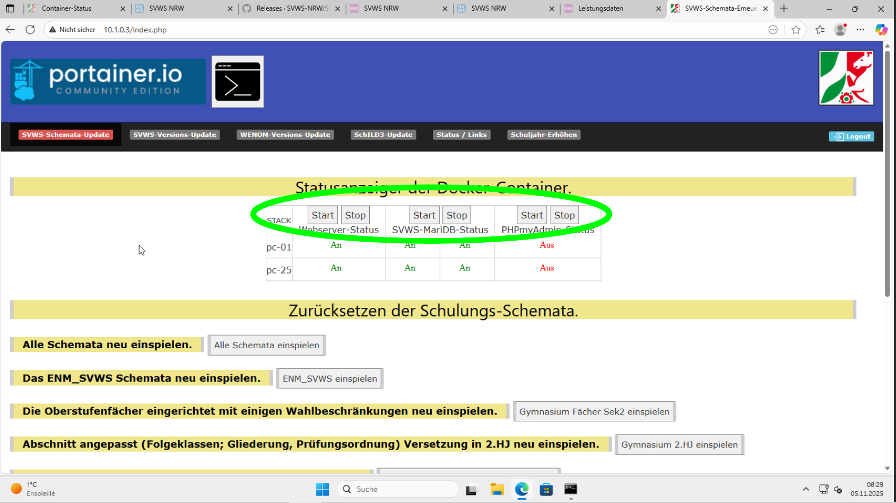

Die Bilder zeigen Zuordnungen wie MO1 zu PC-24 und MO2 zu PC-25. Das beschreibt die lokale Platzverteilung. Prüfe die Verfügbarkeit jedes benötigten Dienstes bzw. Arbeitsplatzes; aus dem ersten und letzten laufenden Rechner folgt nicht, dass alle dazwischen laufen.

Webdienste für WeNoM/WebLuPO werden nur benötigt, wenn sie Teil der Schulung sind. SVWS-Server und MariaDB müssen für SchILD-NRW 3 erreichbar sein. Ein zusätzlicher Datenbank-Verwaltungsdienst ist dafür nicht generell erforderlich.

### Schemata zurücksetzen

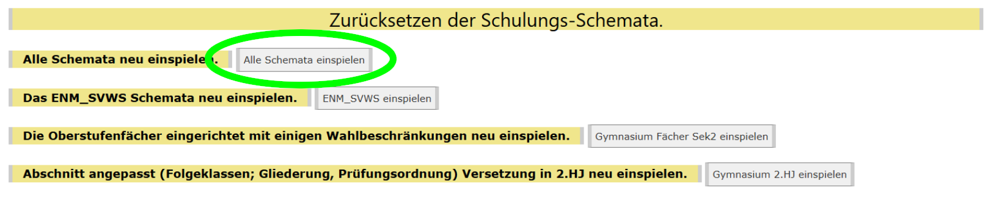

Die Altanleitung beschreibt einen vollständigen Durchlauf mit ungefähr einer Stunde Laufzeit. Das ist eine Beobachtung dieses Aufbaus, keine garantierte Dauer. Bevorzuge während einer Schulung den vorher erprobten Rücksetzweg für das betroffene einzelne Schema.

### SchILD-NRW 3 aktualisieren

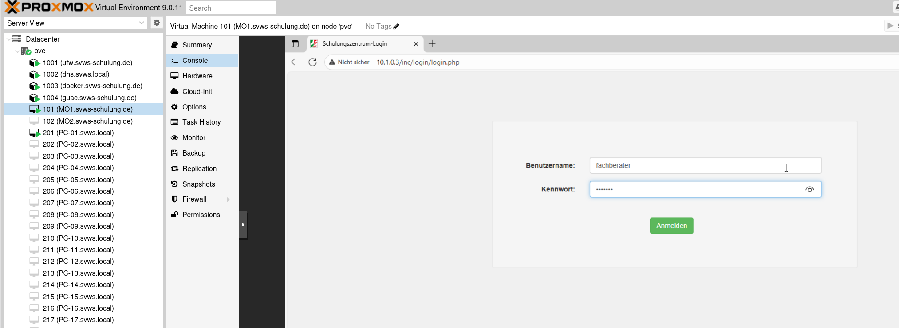

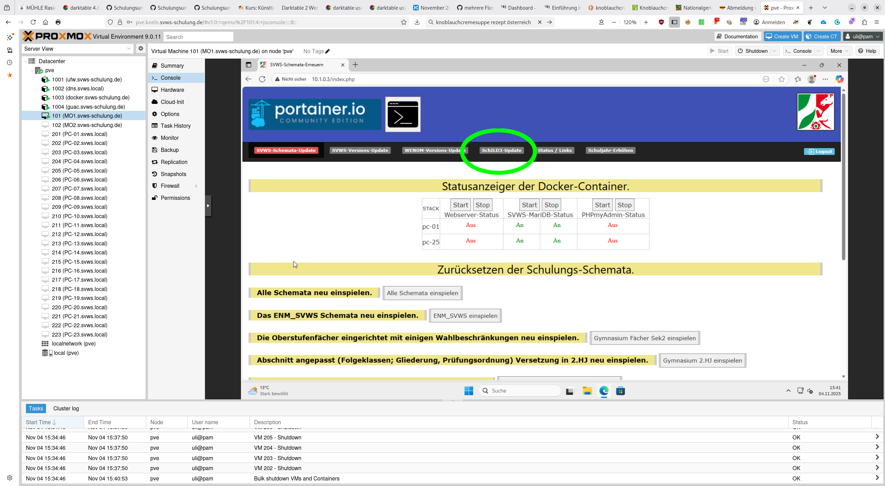

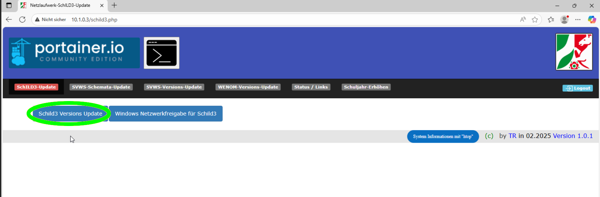

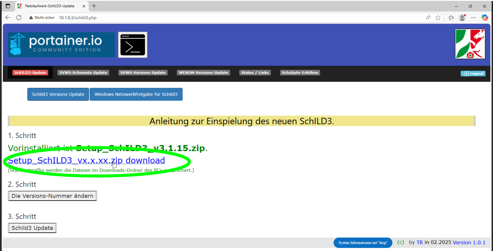

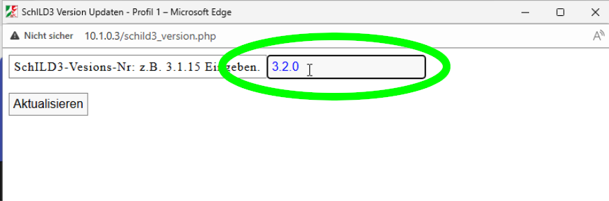

Die frühere Oberfläche trennte Download, Eingabe der Version und eigentliche Verteilung. Prüfe den aktuellen Ablauf mit der Stützpunktleitung. Lade Pakete über die [offizielle SchILD-Installationsseite](https://doku.svws-nrw.de/deployment/Schild-NRW3/) und teste sie zuerst an einem Arbeitsplatz. Ein Versionsfeld allein bestätigt keine erfolgreiche Installation.

### WeNoM aktualisieren und anbinden

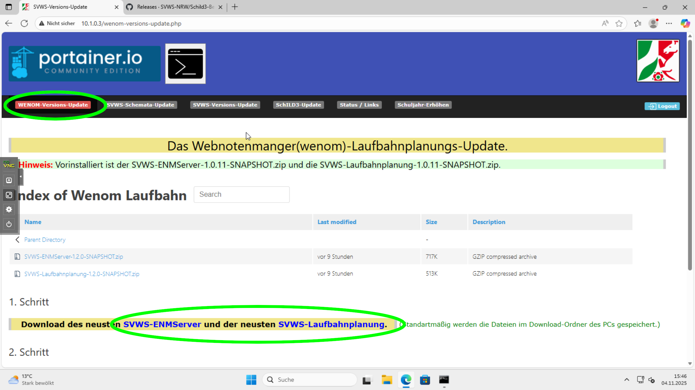

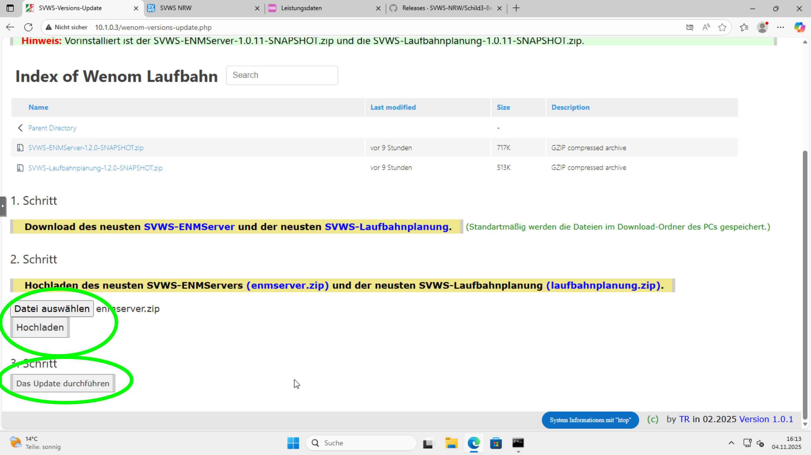

Die alte Oberfläche verwendete getrennte Uploadschritte für Komponenten. Nutze die zur eingesetzten Version gehörenden Pakete. Nach dem Update sind Serveradresse, Kopplung und ein realer Notenübertrag mit dem richtigen Übungsschema zu prüfen. Zugangsdaten und Kopplungsgeheimnisse gehören nicht in eine öffentlich erreichbare Übersichtsseite.

### SVWS-Server aktualisieren

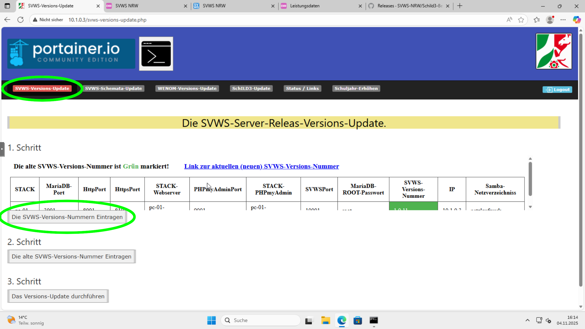

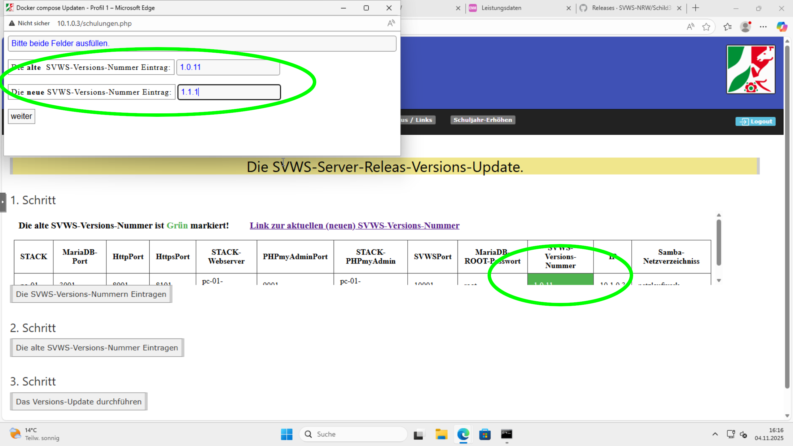

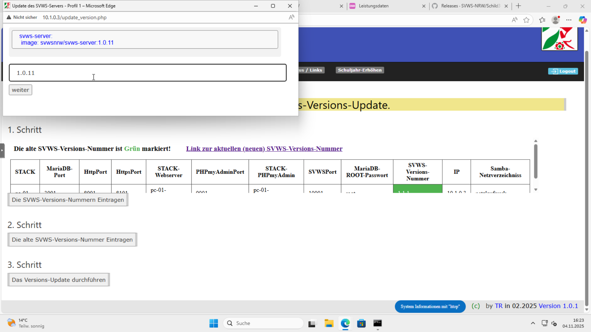

Die Altbeschreibung nennt einen Neuaufbau der Server und ein erneutes Einspielen der Datenbanken. Behandle diese Aktion deshalb als potenziell vollständigen Rücksetzvorgang, bis der Betreiber den tatsächlichen Ablauf bestätigt hat. Die Eingabe alter und neuer Versionsnummern und das Neuladen des Browsers sind kein Nachweis für erhaltene Daten oder ein gelungenes Update.

## Übergabe nach der Wartung

Notiere Datum, ausführende Person, Versionen, verwendetes Ausgangsbackup, Platzzuordnung und Ergebnis der Funktionsprobe. Gib die Umgebung erst frei, wenn die vorgesehenen Aufgaben einschließlich Rücksetzen funktionieren. Bei einem Fehlschlag bleibt die zuvor gesicherte, passende Kombination aus Programmstand, Daten und Konfiguration der Rückweg.
