# Proxmox installieren und das Schulungsnetz vorbereiten

## Ziel und Eingriffsbereich

Du richtest **den Virtualisierungshost** ein, auf dem später die Server-VM oder ein LXC läuft. Dies ist keine Installation des SVWS-Servers. Der Weg gehört zur Stützpunktadministration und wird vor dem Schulungstermin durchgeführt.

Eine Proxmox-Installation auf physischer Hardware kann die ausgewählten Datenträger neu einrichten. Verwende ausschließlich dafür vorgesehene Hardware und eine abgestimmte Datensicherung.

## 1. Installationsweg festlegen

| Ausgangslage | Weg |
| --- | --- |
| Eigener leerer Server mit lokaler Konsole | Offizielles Proxmox-VE-ISO installieren |
| Vorhandener betreuter Proxmox-Host | Keinen zweiten Host installieren; eine eigene Server-VM anlegen |
| Anbieter stellt passendes Debian bereit und erlaubt den Betrieb | Versionspassende Anleitung für Proxmox auf Debian verwenden; Netzwerk und Rettungskonsole vorher klären |
| Proxmox soll innerhalb einer VM erprobt werden | Separates Labor mit Nested Virtualization; kein wartungsarmer Standardaufbau für den Raum |

Für Proxmox VE 9 ist die [Anleitung für Debian 13/Trixie](https://pve.proxmox.com/wiki/Install_Proxmox_VE_on_Debian_13_Trixie) maßgeblich. Vermische keine Paketquellen verschiedener Proxmox-/Debian-Versionen. Eine zusätzliche Desktop-Oberfläche auf dem Host ist für die Verwaltung nicht notwendig.

## 2. Host installieren

1. ISO und Prüfsumme über die [offizielle Proxmox-Seite](https://www.proxmox.com/de/downloads/proxmox-virtual-environment/iso) beziehen.
2. Installationsmedium erstellen und den Server davon starten.
3. Zielplatten, Hostname, Netzadresse, Gateway und DNS sorgfältig auswählen.
4. Verwaltungszugang über die festgelegte Hostadresse und Port 8006 prüfen.
5. Passende [Paketquellen](https://pve.proxmox.com/wiki/Package_Repositories), Updates und Sicherungen einrichten.

Bei Installation auf einem bestehenden Debian-System folge der vollständigen offiziellen Schrittfolge. Das Abschalten des NetworkManagers oder Entfernen von Kerneln aus einem entfernten Terminal kann den Zugang unterbrechen. Es ist keine allgemeine Vorbereitungsanweisung für jeden Schulungsraum.

## 3. Schulungsnetz anbinden

Für eine zentrale Server-VM im vorhandenen Raum-LAN wird üblicherweise eine passende Linux-Bridge verwendet. Der konkrete Adaptername und die IP-Konfiguration stammen von der Raumadministration. Hostname und feste Adresse bzw. DHCP-Reservierung müssen zusammenpassen.

**Nicht einfach aus Beispielen übernehmen:** Interfaces wie `ens18`, `ens3` oder `eth0`, Gateways und DHCP-Bereiche. Ein Server darf weder eine bereits belegte Adresse noch eine Adresse aus einem unkoordinierten DHCP-Bereich erhalten.

Leite nicht pauschal alle TCP- und UDP-Ports in ein internes Netz weiter. Die frühere Beispieladresse `123.45.678.9` war keine gültige IPv4-Adresse; das zugehörige Vollweiterleitungsbeispiel ist deshalb keine verwendbare Netzkonfiguration.

## 4. VM oder LXC anlegen

Für den einfachen Grundaufbau verwende eine **Debian-VM**. Wähle Ressourcen anhand der geplanten gleichzeitigen Nutzung und teste Last und Sicherung. Für kleine Prüfaufbauten sind 2 vCPUs, 8 GB RAM und zunächst 40 GB Platte eine Planungsgröße.

Ein **unprivilegierter Debian-LXC** ist eine Alternative für erfahrene Administration, wenn darin der Linux-Installer betrieben wird. LXC teilt den Hostkernel und ist keine vollständige VM. Docker in LXC ist ein weiterer, gesondert zu betreuender Aufbau und hier nicht der Standard.

Importiere für LXC ein tatsächlich verfügbares Template. Ein Dateiname aus einem alten Screenshot garantiert nicht, dass dieses Template lokal existiert. Host-Storage und Bridge müssen vor dem Anlegen feststehen. Prüfe die Parameter des [LXC-Helfers](https://raw.githubusercontent.com/Raffenberg/SVWS_FBM/6b540c8da74187caed87b4b561a553add2f61fc7/Fachberatung_Anleitungen/Test-_und_Schulungsserver/Proxmox_Schulungsserver/pve_create_lxc.sh) mit `--help`; das Skript legt keinen SVWS-Dienst an.

## 5. Fortgeschrittene Netze und Nested Virtualization

SDN, eigene DHCP-Dienste, NAT, Reverse-Proxy und VPN sind zusätzliche Administrationsaufgaben. Ein SDN-Beispielnetz wäre etwa `10.0.0.0/24` mit einem getrennt festgelegten Gateway, nicht ein universell passendes Netz für alle Räume. Konfiguration und Erreichbarkeit nach jeder Änderung prüfen.

Für einen verschachtelten Proxmox-Test müssen äußere Hardware und Hypervisor die benötigte CPU-Virtualisierung weiterreichen. Ein CPU-Typ `host` allein genügt dafür nicht. Prüfe den aktuellen Zustand am **äußeren Host**, beispielsweise:

```bash
cat /sys/module/kvm_intel/parameters/nested
# Bei AMD stattdessen:
cat /sys/module/kvm_amd/parameters/nested
```

Die frühere, zusammengezogene Zeile zum Entladen und Neuladen von Kernelmodulen war fehlerhaft. Ändere solche Module nicht während des Betriebs laufender Gäste. Plane einen Wartungstermin und verwende die [offiziellen Proxmox-Hinweise](https://pve.proxmox.com/wiki/Nested_Virtualization).

::: details Bilder der bisherigen Beispielinstallation
Die Bilder zeigen konkrete Einstellungen aus dem bisherigen Artikel. Maßgeblich für Adressen, Ressourcen und Versionen ist Dein freigegebener Aufbau.

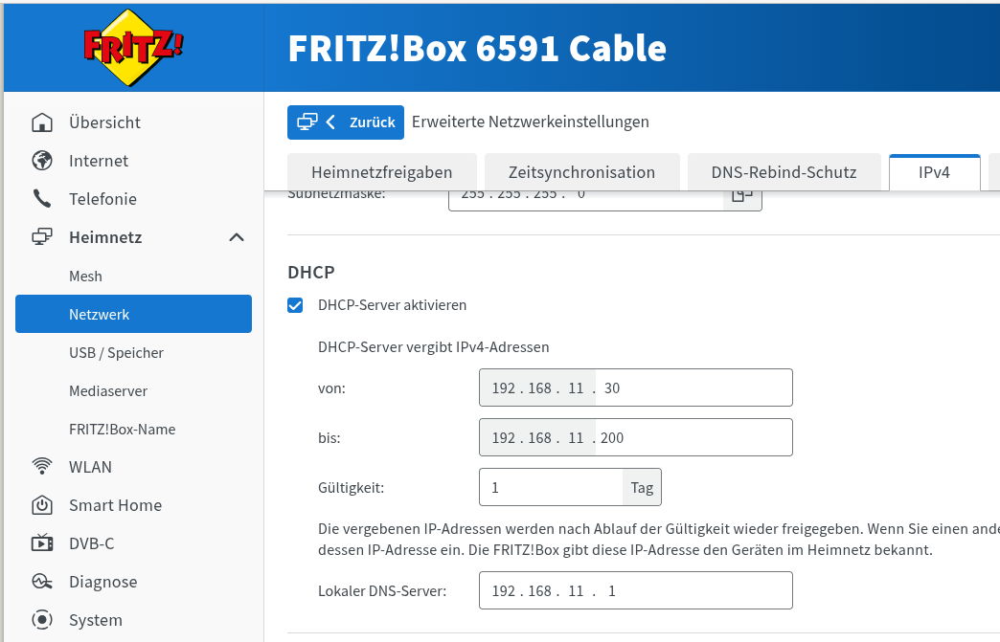

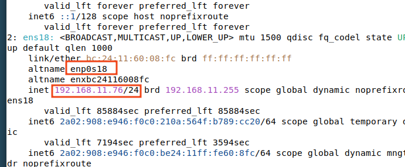

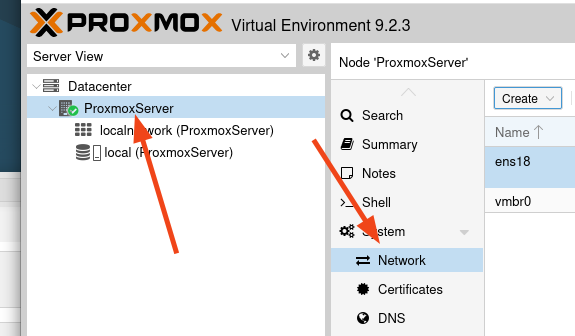

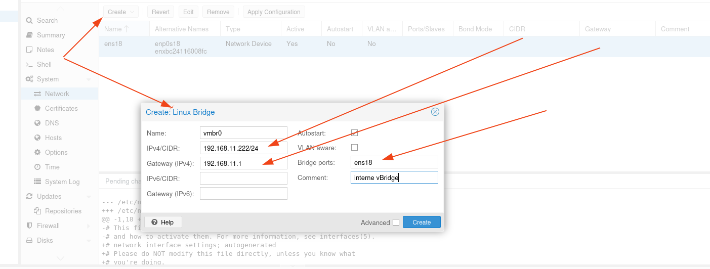

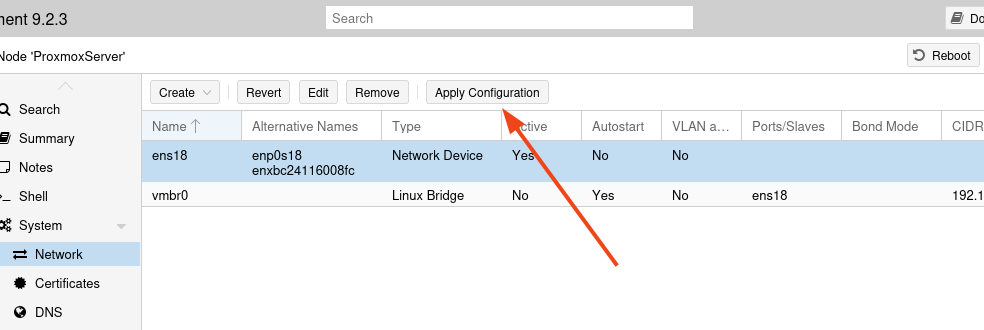

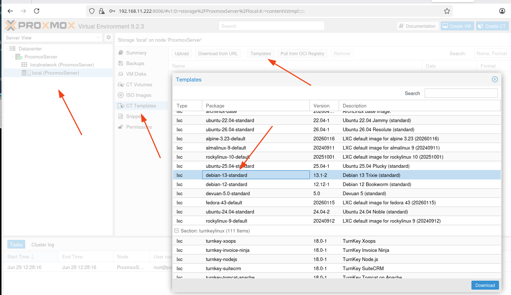

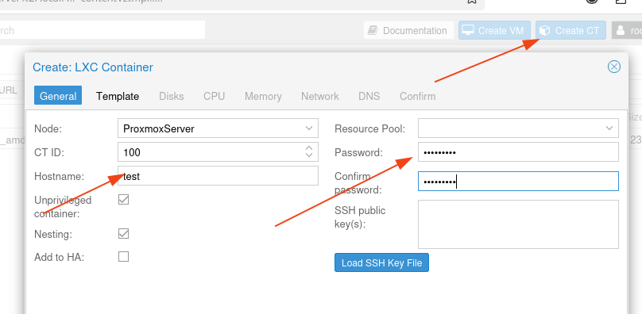

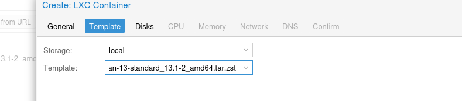

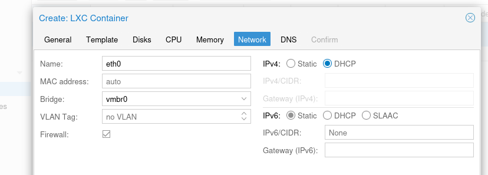

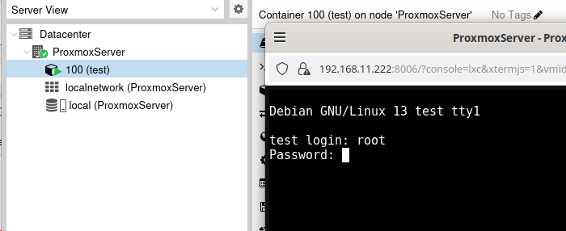

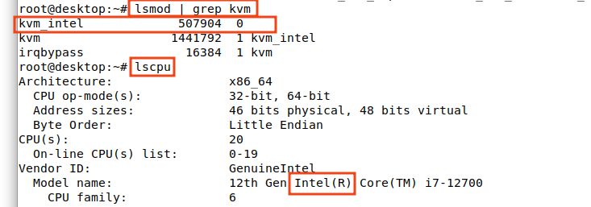

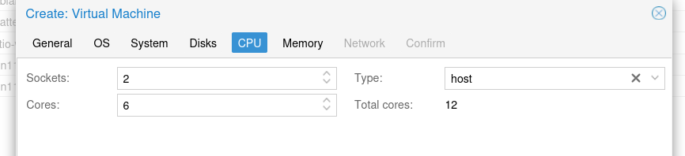

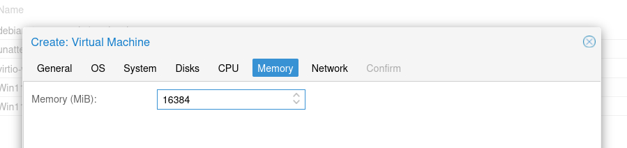

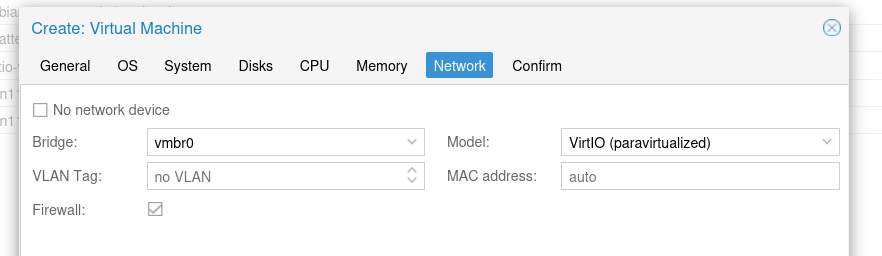
:::

## Abnahme

Der Host ist nach einem Neustart erreichbar, die Server-VM startet geordnet, das Schulungsnetz erreicht nur die vorgesehenen Dienste und eine Sicherung lässt sich auf einer Testinstanz wiederherstellen. Erst danach folgt die [Serverinstallation](../index.md).
