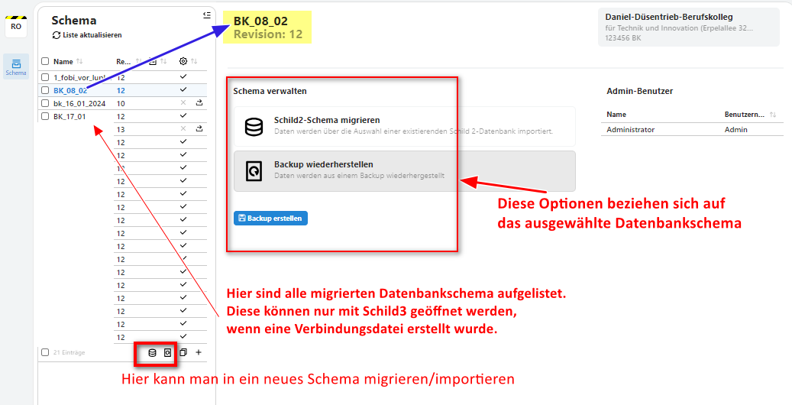

# Admin-Tool

### Öffnen des Admin-Tools
Öffne den Administrationsbereich, indem Du in der Suchleiste vom Browser `localhost/admin` tippst. Ggf. musst Du mit der Langversion `https://localhost/admin ` arbeiten. Nach Eingabe des root-Passwortes, welches Du beim Installieren des SVWS-Servers festgesetzt hast, sollte diese Oberfläche sichtbar werden:   

### Migrieren einer weiteren Datenbank
* Migriere über das Admin-Tool eine weitere Datenbank in ein neues Schema.
* Erstelle anschließend eine Verbindungsdatei, sodass Du die Datenbank auch mit SchILD3 öffnen kannst.

### Backup erstellen
Sichere eine Datenbank in eine SQLite Datenbank.
> [!TIP] 
> Das Backup wird automatisch im Download-Ordner gesichert.

### Backup wiederherstellen
Importiere die gerade erstellte Sicherung in ein neues Schema.

### Leeres Schema erstellen
Erstelle ein leeres Schema und öffne dieses im Client unter Angabe einer Schulnummer.

### Backup in ein bestehendes Schema importieren
Importiere das SQLite-Backup in das leere Datenbankschema.

