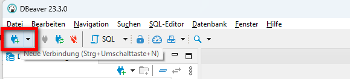
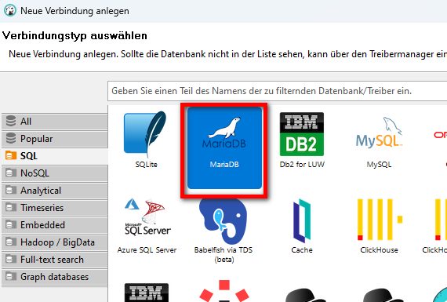
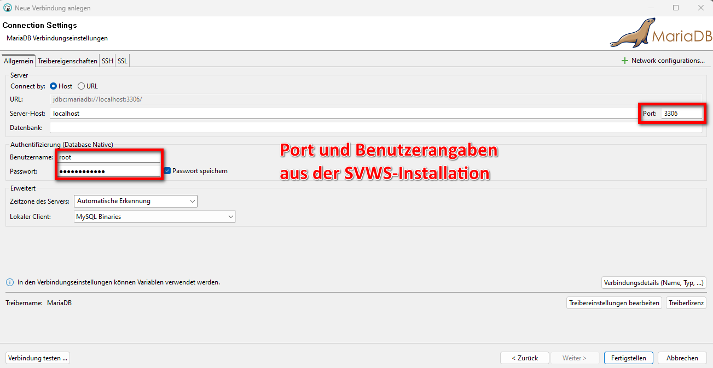
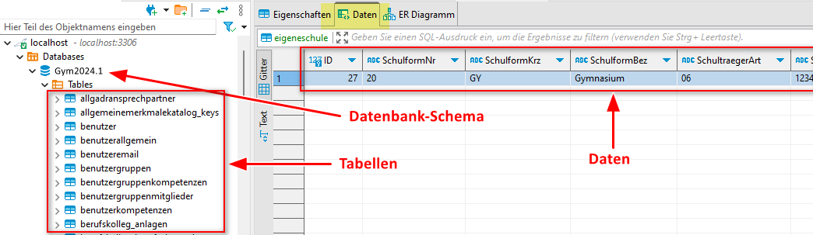
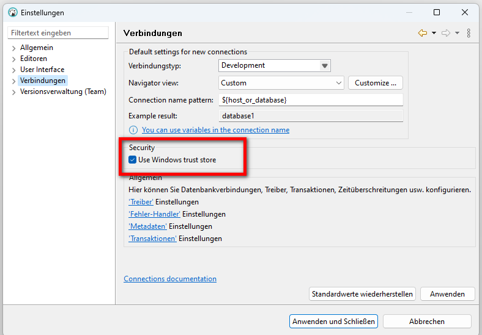

# Öffnen der Datenbanken mit DBeaver

### Installation von DBeaver
Installiere DBeaver, sofern das Programm noch nicht auf Deinem Rechner installiert ist:
https://dbeaver.io/download/

Öffne das Programm anschließend.

### Datenbankverbindung öffnen:
1. Wähle **Neue Verbindung anlegen** aus.       
 

2. Wähle als Datenbank **MariaDB** aus.   

3. Gib **Port und Benutzerangaben** an. Diese Angaben wurden bei der SVWS-Serverinstallation festgelegt.   

4. Über die linke Leiste können einen Tabellen ausgewählt und gesichtet werden:   

> [!TIP] 
> Bei Problemen sollte man diese Einstellung einmal überprüfen:
> 
