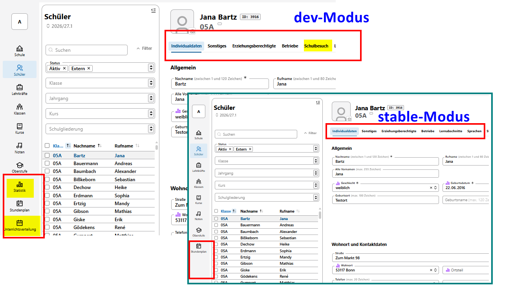
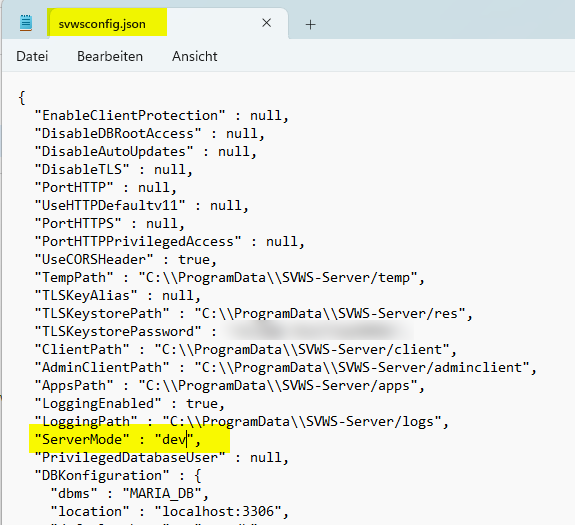

# Hier kommt dein SVWS-Hack der Woche

Wusstest du schon, dass der SVWS-Server **vier Modi** hat, die steuern, welche Funktionen für dich sichtbar sind?    

Je nach Modus (stable, dev, alpha oder beta) entscheidet der SVWS-Server, was auf der Oberfläche sichtbar ist – von nur fertigen Bereichen (stable = Stabil) bis hin zu brandneuen Test-Funktionen und Menüpunkten, die sich im Aufbau befinden (dev = Development/Entwicklung ). Beta und alpha ist irgendwas dazwischen. 

**Wichtig**      
**Eine Schule sollte immer den stable-Modus nutzen.** Der dev-Modus gehört ausschließlich in eine getrennte Testumgebung mit Spieldaten.

Hier ein Beispiel: Die Bereiche Statistik, Unterrichtsverteilung, sowie Schulbesuch sind nur im dev-Modus sichtbar. 

 
|  |
|---------------|

## Von stable zu dev für Spieldatenbanken

Der Modus steht in der Datei svwsconfig.json. Diese liegt hier

+ unter Linux liegt sie in /opt/app/svws
+ unter Windows in C:\ProgramData\SVWS-Server\res 

Ändere den Eintrag unter ServerMode zu "dev":
|  |
|---------------|

Die Änderung wird erst nach einem Neustart des Servers wirksam. 

:back: [Zurück zu den Tipps der Woche](./../index.md)   