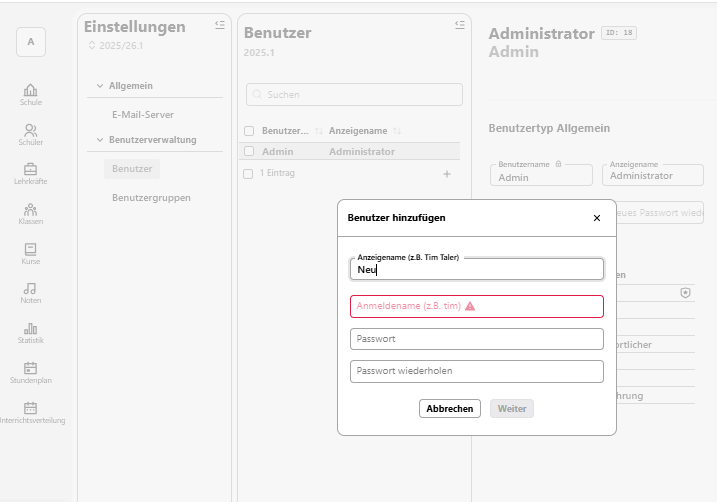
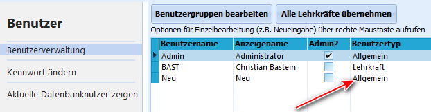
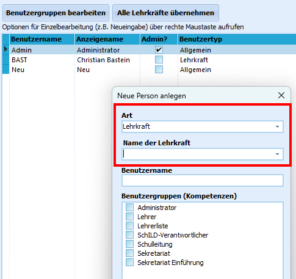

# Hier kommt dein SVWS-Hack der Woche

Wusstest du schon, dass du derzeit beim **Anlegen eines Benutzers über den Client** nicht festlegen kannst, dass es sich um eine Lehrkraft handelt?    

Das ist eine noch fehlende Funktion im Client (Version 1.5.1). Sie ist bereits gemeldet und die Entwickler arbeiten daran. Nutze bis zur Korrektur besser SchILD-NRW3, um Lehrkräfte als Benutzer hinzuzufügen.    

### Anlegen einer Benutzers im Client

Unter Einstellungen/Benutzerverwaltung/Benutzer kann im Client ein neuer Benutzer hinzugefügt werden. In der aktuellen SVWS-Version 1.5.1 können an dieser Stelle nur Anzeigename, Anmeldename und Passwort angegeben werden. Eine Auswahl des Benutzertyps ist nicht möglich. Der neue Benutzer bekommt deshalb den Benutzertyp "Allgemein" und ist nicht mit einer Lehrkraft verknüpft. Eine anschließende Korrektur in Schild3 ist nicht möglich.     

 
|  |
|---------------|

In SchILD-NRW3 sieht man das Ergebnis in der Benutzerverwaltung: Der Benutzer "Neu" hat den Benutzertyp "Allgemein", die Lehrkraft BAST dagegen "Lehrkraft".

 
|  |
|---------------|

### Lösung: Anlegen eines Benutzers über Schild3

+ Benutzerverwaltung öffnen
+ Neuen Benutzer anlegen (mit der rechten Maustaste)
+ Bei Art "Lehrkraft" wählen und bei Name der Lehrkraft die Lehrkraft auswählen
+ Benutzernamen und Benutzergruppen (Kompetenzen) festlegen

|  |
|---------------|

:back: [Zurück zu den Tipps der Woche](./../index.md)   