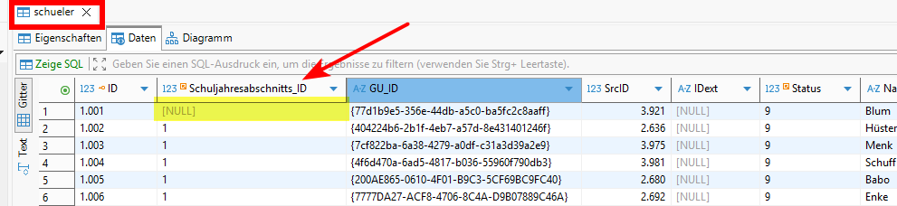
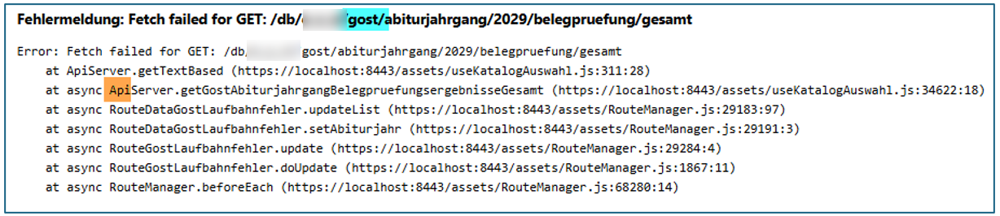
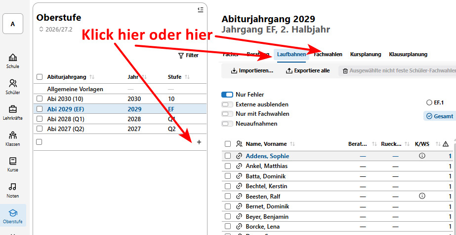

# Hier kommt dein SVWS-Hack der Woche

Wusstest du schon, dass es unter Umständen Schüler in der Datenbank gibt, die keinen eingetragenen Schuljahresabschnitt haben und dadurch eine Fehlermeldung in der Oberstufen-App auslösen?

## In der Datenbank sieht das so aus:    
|  |
|---------------|

## Wie kommt der Null-Eintrag zustande?

Bei den mir bekannten Fällen, handelt es sich um SuS, die in Schild2 angelegt wurden und vor einem Neustart von Schild2 wieder gelöscht wurden oder sofort auf Abgang gesetzt wurden. Die SuS haben auch keine Lernabschnittsdaten und waren nie an der Schule.

## Wie erkenne ich den Fehler im Client?
Die Fehlermeldung kann beim Anlegen eines Abiturjahrgangs auftreten oder beim Klick auf einen Unterreiter einer Abiturjahrgangs:    

|  |
|---------------|

Der Anwender erhält in etwa eine solche Rückmeldung:
|  |
|---------------|

## Was rate ich den Schulen?
Mit dem kommenden Release werden diese Fälle abgefangen, sodass der Bug dann nicht mehr auftritt. Wenn man das Release nicht abwarten möchte, kann die Schuljahresabschnitts_ID in der Datenbank nachtragen werden oder der Schüler kann nach Rücksprache aus der Datenbank gelöscht werden - sofern der Schüler nie an der Schule war.

:back: [Zurück zu den Tipps der Woche](./../index.md)   