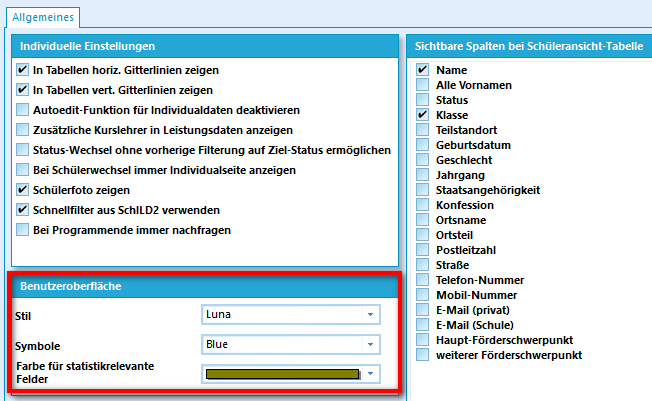
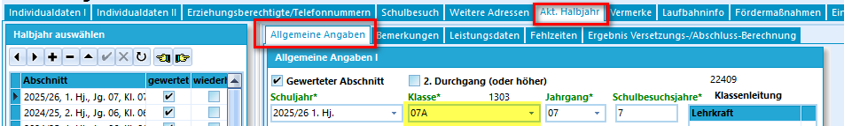
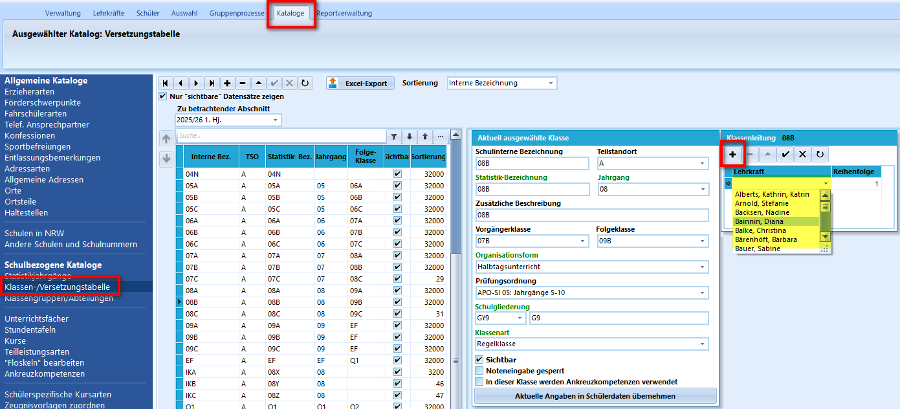

# Anpassungen bei den Schülerdaten
Die meisten Anpassungen und Arbeitsschritte können sowohl in der Desktop-Anwendung SchILD-NRW3 (Im folgenden kurz schILD3) als auch in der Browser-Variante (im folgenden kurz SVWS-Client) vorgenommen werden. Da der SVWS-Client stetig weiterentwickelt wird und immer mehr Funktionalitäten dort implementiert werden, empfehle ich, überwiegend mit dem SVWS-Client zu arbeiten. 

## Statistik-relavante Felder

In SchILD3 sind bei den Individualdaten I und II die zu erfassenden Daten überwiegend identisch zu den Daten in SchILD2. Die Anordnung wurde ein wenig angepasst und das Schülerfoto ist nun unter Individualdaten I stets sichtbar, sofern ein Bild hinterlegt ist und die Sichtbarkeit eingestellt ist. Das Sternchen an den Überschriften signalisiert die Relevanz für die Statistik. Dies ist auf den ersten Blick etwas unscheinbar.

### :a: Aufgabe - Farbe der Statistikfelder anpassen
Ändere die Farbe für statistikrelevante Felder auf grün. 
::: details
1. Wechsle in den Reiter "Verwaltung" und wähle "Einstellungen/Individuelle Einstellungen" aus
2. Ändere die Farbe für statistikrelevante Felder wie gewünscht:
     
:::

## Aktuelles Halbjahr
Bisher konnten die Laufbahndaten sowohl unter Individualdaten I als auch im aktuellen Halbjahr geändert werden. Nun sind unter Individualdaten I die Felder der Laufbahndaten ausgegraut. Änderungen sind nun nur noch im aktuellen Halbjahr möglich. Analog findet man graue Felder bezüglich der Förderschwerpunkte unter Individualdaten II. Da sich diese Angaben immer nur auf den aktuellen Abschnitt beziehen, sind Änderungen diesbezüglich nur noch im aktuellen Halbjahr möglich.
### :a: Aufgabe - Klassenwechsel eines Schülers
Ein Schüler wechelt von der 7a in die 7b. Nimm notwendige Änderungen vor.

::: details
1. Wechsle in den Reiter Aktuelles Halbjahr / Allgemeine Angaben:
    
2. Ändere die Klasse auf 7b. 
3. Passe die Fächer in den Leistungsdaten an. Hier hat sich nichts geändert im Vergleich zu SchILD2.
:::

### :a: Aufgabe - Eintragen des Förderschwerpunkts 
Ein Schüler aus der 5a hat eine Sehbehinderung. Hinterlege den entsprechenden Förderschwerpunkt in SchILD3
::: details
Auch diese Angaben werden im aktuellen Halbjahr / Allgemeine Angaben gesetzt.
:::

## Kataloge - Klassen-/ Versetzungstabelle
Unter dem aktuellen Halbjahr findet man auch den derzeitigen Klassenlehrer des Schülers. Hier gibt es keine Möglichkeit diesen zu ändern. Dazu muss man einmal in die Klassen- und Versetzungstabellen, welche man in SchILD2 unter Schulverwaltung öffnen konnte. Diese sind nun unter dem Reiter "Kataloge" zu finden. Genauer handelt es sich bei den Klassen- und Versetzungstabellen um schulbezogene Kataloge:

  
### :a: Aufgabe - Klassenlehrer anpassen
1. Ändere den Klassenlehrer der 8a. 
2. Trage zusätzlich einen Stellvertreter ein. Die Reihenfolge gibt Auskunft darüber, welcher Klassenlehrer der Stellvertreter ist.
3. Übertrage diese Angaben in die Schülerdaten.  

## Vermerke
Die Vermerke sind umgezogen!  
Bisher waren die Vermerke unter "Laufbahninfo" des jeweiligen Schülers zu finden.  
Nun findet sich bei jedem Schüler ein eigener Reiter "Vermerke".  
Analog zu den Klassen- und Versetzungstabellen findet man den Katalog der Vermerk-Arten nun unter Kataloge (früher unter Schulverwaltung).

### :a: Aufgabe - Einen Vermerk bei einem Schüler hinterlegen
1. Ergänze die Vermerkart "Attestpflicht".
2. Vermerke bei einem Schüler aus der Q1 die Attestpflicht.

::: details
Hilfe findest Du auch [hier](https://schulverwaltungsinfos.nrw.de/svws/wiki/index.php?title=Vermerke_(Sch%C3%BCler))
:::

## Migrationshintergrund
Die Angaben zum Migrationshintergrund findet man nach wie vor unter Individualdaten II. Der Bereich ist allerdings nun unterteilt in "Migrationshintergrund" und "Zuwanderung". Weiter gibt es bei den Einstellungen keine Möglichkeit mehr, die vereinfachte Darstellung der Migrationseintragung zu nutzen. 

