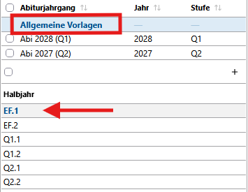
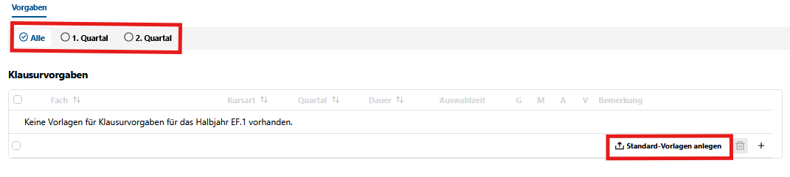

# 1. Allgemeine Vorlagen

## Grundsätzlicher Hinweis zur Klausurplanung

Die Klausurplanung erfolgt auf **Basis der für die Schüler hinterlegten Leistungsdaten**.

Prüfen Sie also zunächst, ob für die Schüler der zu planenden Stufe Kurse im betrachteten Lernabschnitt (also Kursbelegungen) vorliegen.

Im Praxisbetrieb sollten die Schriftlichkeiten über die individuellen Kursarten (LK1, LK2, GKS, GKM, AB3, AB4) korrekt vorliegen.

:information_source: [Doku: Leistungsdaten](https://doku.svws-nrw.de/svws-client/apps/schueler/lernabschnitte/leistungsdaten/)

::: info 📝 Aufgabe 1.1 „Datenbasis prüfen“
1. Wählen Sie zwei bis drei Schüler des zu planenden Jahrgangs aus und öffnen Sie deren **Leistungsdaten** im aktuellen Lernabschnitt.
2. Prüfen Sie, ob Kursbelegungen vorhanden sind und ob die Kursarten (LK1, LK2, GKS, GKM, AB3, AB4) die Schriftlichkeit korrekt abbilden.
:::

## Allgemeine Vorlagen

In der allgemeinen Vorlage legen Sie schulweit fest, in welchen Fächern und Kursarten pro Abschnitt und Quartal Klausuren geschrieben werden und mit welchen Rahmenbedingungen (z. B. Dauer). Im System ist bereits eine Standardvorlage hinterlegt, die Sie aufrufen und bearbeiten können. Zusätzliche Fächer können mit **+** ergänzt werden.

::: tip Hinweis
In den allgemeinen Vorlagen werden auch die Einstellungen der **gleichwertig komplexen Leistungsnachweise (gkL)** vorgenommen.
:::

:information_source: [Doku: Vorgaben erstellen](https://doku.svws-nrw.de/svws-client/apps/gost/klausurplanung/#vorgaben-erstellen)

### Einstellungen in der allgemeinen Vorlage

Die Vorlage finden Sie unter **Oberstufe ➜ Allgemeine Vorlagen ➜ Klausurplanung**.

::: info 📝 Aufgabe 1.2 „Standard-Vorlagen anlegen“
Führen Sie die folgenden Schritte für **alle sechs Abschnitte** von EF.1 bis Q2.2 aus:

1. Wählen Sie **Oberstufe ➜ Allgemeine Vorlagen ➜ Klausurplanung**.
2. Legen Sie die im Programm fest hinterlegten **Standard-Vorlagen** für Klausuren an.
3. Achten Sie darauf, dass Sie das für jedes Quartal durchführen (Einstellung **„Alle“**).
:::

::: info 📝 Aufgabe 1.3 „Klausurparameter bearbeiten“
1. Bearbeiten Sie nun für jeden Abschnitt die Klausureinstellungen hinsichtlich der zur Verfügung stehenden Parameter.
2. Passen Sie die Werte an die Vorgaben Ihrer Schule an.
3. Ergänzen Sie bei Bedarf ein fehlendes Fach über **+**.
:::

## Gleichwertig komplexe Leistungsnachweise (gkL) ab Abitur 2030

Damit die gkL in der Laufbahnplanung zur Verfügung stehen, werden sie in der Klausurplanung für die jeweiligen Fächer in den Abschnitten pro Quartal nach den Vorgaben der Schule aktiviert. Die Eintragung erfolgt in der **allgemeinen Vorlage** oder individuell für jeden Abiturjahrgang.

::: tip Hinweis
Die Spalte **G** steht im weiteren Verlauf für die einzelnen Abiturjahrgänge erst ab dem Jahrgang 2030 zur Verfügung. In früheren Jahrgängen wird sie automatisch ausgeblendet.
:::

::: tip Beachten Sie
Gemäß den hier getätigten Einstellungen stehen den Schülern ab Abiturjahrgang 2030 die Auswahlmöglichkeiten der **gkL in der Laufbahnplanung** zur Verfügung.
:::

:information_source: [Doku: Gleichwertig komplexe Leistungsnachweise (gkL)](https://doku.svws-nrw.de/svws-client/apps/gost/klausurplanung/gkL/)  
:information_source: [Doku: Laufbahnen](https://doku.svws-nrw.de/svws-client/apps/gost/laufbahn/)

::: info 📝 Aufgabe 1.4 „gkL festlegen“
1. Setzen Sie in der allgemeinen Vorlage in der Spalte **G** gemäß den Schulvorgaben die **gkL**.
2. Beispiel, falls keine Schulvorgaben vorliegen: In EF.1 im 2. Quartal für Ku, Mu, alle gesellschaftswissenschaftlichen und alle naturwissenschaftlichen Fächer inkl. Mathematik.
3. Prüfen Sie für einen Abiturjahrgang ab 2030, ob die gkL in der **Laufbahnplanung** auswählbar sind.
:::
