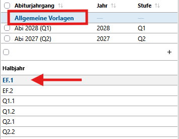
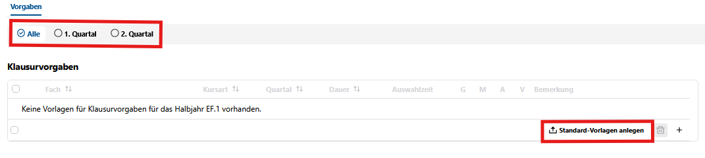

# Grundsätzlicher Hinweis zur Klausurplanung  

Die Klausurplanung erfolgt auf **Basis der für die Schüler hinterlegten Leistungsdaten**.  
  
Prüfen Sie also zunächst, ob für die Schüler der zu planenden Stufe Leistungsdaten (also Kursbelegungen) vorliegen. 
  
Im Praxisbetrieb sollten die Schriftlichkeiten über die individuellen Kursarten (LK1, LK2, GKS, GKM, AB3, AB4) korrekt vorliegen.

# Allgemeine Vorlagen

::: tip Hinweis:  
in den allgemeinen Vorlagen werden auch die Einstellungen der **gleichwertig komplexen Leistungsnachweise (gkL)** vorgenommen.
:::
>DOKU-Link: [Vorlagen Klausurplanung](https://doku.svws-nrw.de/svws-client/apps/gost/klausurplanung/#vorgaben-erstellen)

## **Einstellungen in der allgemeinen Vorlage**  

Wählen Sie in **Oberstufe -> Allgemeine Vorlagen -> Klausurplanung** aus.

Führen Sie die nächsten Schritte für alle sechs Abschnitte von EF.1 bis Q2.2 aus:  

Legen Sie die im Programm fest hinterlegten **Standard-Vorlagen** für Klausuren an.  
Achten Sie darauf, dass Sie das für jedes Quartal (Einstellung "Alle") durchführen.

Bearbeiten Sie nun für jeden Abschnitt die Klausureinstellungen hinsichtlich der zur Verfügung stehenden Parameter.

## **gleichwertig komplexe Leistungsnachweise (gkL) ab Abitur 2030**  

In der Spalte **G** setzen Sie gemäß den Schulvorgaben die gkL.  
>[!TIP]Hinweis: Die Spalte **G** steht im weiteren Verlauf für die einzelnen Abiturjahrgänge erst ab den Jahrgängen 2030 zur Verfügung. In früheren Jahrgängen wird sie automatisch ausgeblendet.  

>[!TIP]Beachten Sie: Gemäß der hier getätigten Einstellungen stehen den Schülern ab Abiturjahrgang 2030 die Auswahlmöglichkeiten der **gkL in der Laufbahnplanung** zur Verfügung.