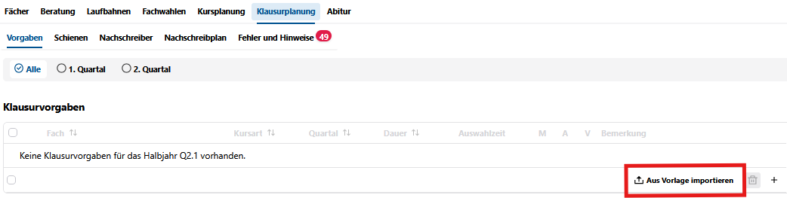

# Übernahme in Jahrgänge

**Wählen Sie den zu planenden Abiturjahrgang aus**

Entscheiden Sie: Planen Sie alle oder den aktuellen Abschnitt.  

Übernehmen Sie für die aktuelle Q2 für den aktuellen Abschnitt in den Vorgaben die Einstellungen der allgemeinen Vorlage.

  

Achten Sie darauf, ob Sie für beide Quartale oder nur ein Quartal planen. In **Q2.2** wird nach **Halbjahr (Vorabitur)** und **Abitur** unterschieden.

Es können Individuelle Anpassungen abweichend von der Vorlage gemacht werden, entscheiden Sie aber, ob diese nicht auch in die allgemeine Vorlage übernommen werden sollten.