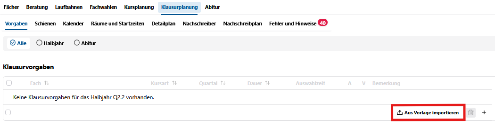

# 2. Vorgaben pro Abschnitt – Übernahme in Jahrgänge

Die allgemeine Vorlage gilt schulweit. Damit sie für einen konkreten Abiturjahrgang wirkt, wird sie in dessen Abschnitte übernommen (**Vorlage importieren**). Danach können für den Jahrgang abweichende Einstellungen vorgenommen werden.

:information_source: [Doku: Vorlagen an Jahrgangsstufen zuweisen](https://doku.svws-nrw.de/svws-client/apps/gost/klausurplanung/#vorlagen-an-jahrgangsstufen-zuweisen)

::: tip Hinweis
Achten Sie darauf, ob Sie für beide Quartale oder nur ein Quartal planen. In **Q2.2** wird nach **Halbjahr (Vorabitur)** und **Abitur** unterschieden.
:::

::: info 📝 Aufgabe 2.1 „Vorlage in den Jahrgang übernehmen“
1. Wählen Sie den zu planenden **Abiturjahrgang** aus (Beispiel: die aktuelle Q2).
2. Entscheiden Sie: Planen Sie **alle Abschnitte** oder nur den **aktuellen Abschnitt**?
3. Übernehmen Sie für den aktuellen Abschnitt in den **Vorgaben** die Einstellungen der allgemeinen Vorlage (**Vorlage importieren**).
4. Prüfen Sie, ob beide Quartale bzw. in Q2.2 Halbjahr und Abitur übernommen wurden.
:::

::: info 📝 Aufgabe 2.2 „Individuelle Anpassungen“
1. Nehmen Sie im Jahrgang eine Anpassung abweichend von der Vorlage vor, z. B. eine andere Klausurdauer in einem Fach.
2. Entscheiden Sie, ob diese Anpassung nicht auch in die **allgemeine Vorlage** übernommen werden sollte, damit sie für künftige Jahrgänge gilt.
:::
