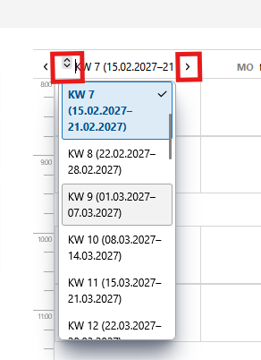

# 4. Kalender – Termine setzen

::: warning Voraussetzung
Um Termine mit der Kalenderfunktion setzen zu können, muss für die Jahrgangsstufe eine Stundenplanung vorliegen, siehe [Startseite](./index.md).
:::

:information_source: [Doku: Klausurtermine im Kalender festlegen](https://doku.svws-nrw.de/svws-client/apps/gost/klausurplanung/#klausurtermine-im-kalender-festlegen)  
:information_source: [Doku: Stundenpläne erstellen und bearbeiten](https://doku.svws-nrw.de/svws-client/apps/stundenplan/stundenplan_anleitung/)

Im Kalender setzen Sie die geblockten Termine per Drag & Drop. Beim Schieben erscheinen in der Kalenderansicht die Stundenplanlagen der betroffenen Kurse.

::: tip Hinweise
- Mit der Funktion **Jahrgangsübergreifend** werden bereits gesetzte Termine anderer Jahrgangsstufen berücksichtigt.
- Beachten Sie das rechte **Hinweisfenster**: Hier werden Terminkollisionen, aber auch Warnungen bei drei und mehr Klausuren pro Woche eines Schülers angezeigt.
:::

::: info 📝 Aufgabe 4.1 „Termine in den Kalender setzen“
1. Wählen Sie die **Woche** aus, in der die Klausurschiene terminiert werden soll.
2. Schieben Sie per Drag & Drop einen Klausurtermin in die passende Terminlage.
3. Achten Sie beim Schieben auf die eingeblendeten Stundenplanlagen der betroffenen Kurse.
4. Setzen Sie alle Termine des ersten Quartals.
:::

::: info 📝 Aufgabe 4.2 „Jahrgangsübergreifend planen“
1. Aktivieren Sie **Jahrgangsübergreifend**.
2. Prüfen Sie, ob Ihre Termine mit bereits gesetzten Terminen anderer Jahrgangsstufen kollidieren.
3. Werten Sie das **Hinweisfenster** aus und verschieben Sie bei Bedarf einen Termin.
:::
