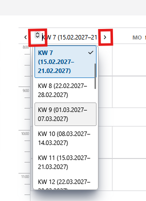

# Termine im Kalender setzen  

>**Hinweis:** Um Termine mit der Kalenderfunktion setzen zu können, muss für die Jahrgangsstufe eine Stundenplanung vorliegen, siehe [Startseite](./index.md)  

>Doku-Link: [Termine im Kalender setzen](https://doku.svws-nrw.de/svws-client/apps/gost/klausurplanung/#klausurtermine-im-kalender-festlegen)

Wähle die Woche aus, in der die Klausurschiene terminiert werden soll.

Schiebe per Drag&Drop den Klausurtermin in die jeweilige Terminlage. Beim Schieben erscheinen in der Kalenderansicht die Stundenplanlagen der betroffenen Kurse.