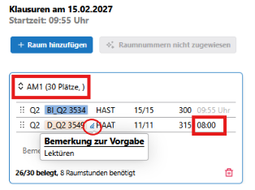

# 5. Räume und Startzeiten

:information_source: [Doku: Räume und Startzeiten festlegen](https://doku.svws-nrw.de/svws-client/apps/gost/klausurplanung/#raume-und-startzeiten-festlegen)  
:information_source: [Doku: Räume (Raumliste)](https://doku.svws-nrw.de/svws-client/apps/stundenplan/allgemeine_vorlagen/raeume/)

Nach Auswahl eines Termins (Ansicht „In Planung“) legen Sie über **„+ Klausurraum anlegen“** einen oder mehrere Klausurräume an. Jedem Klausurraum werden per Drag & Drop eine oder mehrere Klausuren des Termins zugewiesen.

Für einzelne Räume bzw. Klausurgruppen können die Startzeiten abweichend von der Kalendersetzung manuell eingetragen werden:

::: tip Hinweis
Hier können auch Bemerkungen zur Vorgabe angesehen werden (Mouse-over).
:::

::: info 📝 Aufgabe 5.1 „Klausurräume planen“
1. Wählen Sie einen bereits im Kalender gesetzten Termin aus.
2. Legen Sie entsprechend dem Bedarf Klausurräume an (**+ Klausurraum anlegen**).
3. Fügen Sie per Drag & Drop passende Kurse den Räumen zu.
4. Wählen Sie für jede Raumgruppe einen Raum aus der **Raumliste** aus.
:::

::: info 📝 Aufgabe 5.2 „Abweichende Startzeit“
1. Tragen Sie für einen Raum bzw. eine Klausurgruppe eine von der Kalendersetzung abweichende **Startzeit** ein.
2. Sehen Sie sich per Mouse-over die **Bemerkungen zur Vorgabe** an.
:::
