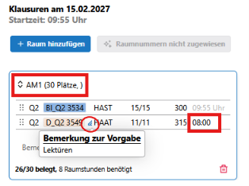

# Räume und Startzeiten  

>Doku-Link: [Räume und Startzeiten](https://doku.svws-nrw.de/svws-client/apps/gost/klausurplanung/#raume-und-startzeiten-festlegen)  

Lege entsprechend der Bedarfe Räume an. 
  
Füge entprechend passende Kurse den Räumen zu (Drag&Drop).  
  
Wähle für jede Raumgruppe auch einen Raum aus der Raumliste aus.  

Für einzelne Räume bzw. Klausurgruppen können die Startzeiten abweichend von der Kalendersetzung manuell eingetragen werden:  

  
  
Hier können auch Bemerkungen zur Vorgabe (Fly-Over mit der Maus) angesehen werden.

