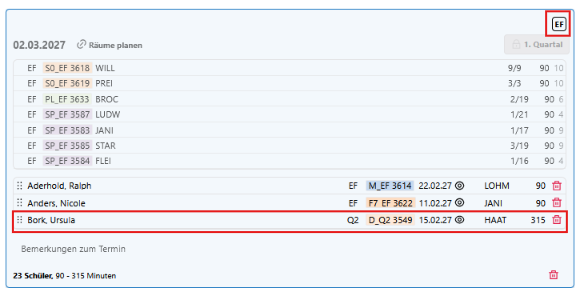
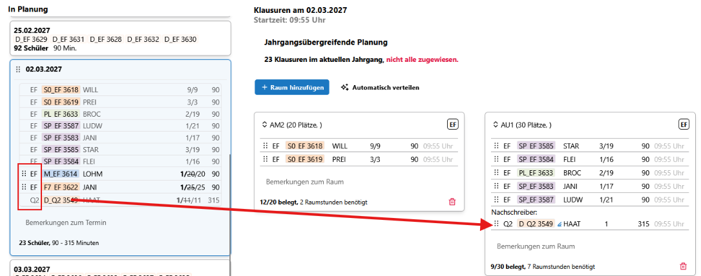

# 7. Nachschreibtermine

:information_source: [Doku: Klausurversäumnis/Nachschreiber](https://doku.svws-nrw.de/svws-client/apps/gost/klausurplanung/#klausurversaumnis-nachschreiber)

## Erfassung von Schülern

Das Versäumnis kann aus Perspektive des betroffenen Schülers oder aus Perspektive des betroffenen Kurses erfasst werden:

- **Möglichkeit 1 – über den Schüler:** Schüler aufrufen ➜ **Lernabschnitte ➜ Klausuren**. Über den Button hinter der versäumten Klausur wird das Versäumnis eingetragen, bei Bedarf mit Angabe eines Grundes (DSGVO beachten).
- **Möglichkeit 2 – über die Klausurplanung:** Im Tab **Schienen** die betroffene Klausur anklicken. In der Schülerliste wird das Versäumnis über den Button hinter dem Namen erfasst. Mit **„Nachschreibtermin erstellen“** wird der Schüler in die Liste der Nachschreiber übernommen.

:information_source: [Doku: Erfassung von Versäumnissen](https://doku.svws-nrw.de/svws-client/apps/gost/klausurplanung/#erfassung-von-versaumnissen)  
:information_source: [Doku: Lernabschnitte des Schülers](https://doku.svws-nrw.de/svws-client/apps/schueler/lernabschnitte/)

::: warning Hinweise
- Ein Versäumnis kann nur in den Leistungsdaten des Schülers wieder **entfernt** werden.
- Beachten Sie die unter **Schienen** aufgeführten Teilnehmerzahlen.
:::

::: info 📝 Aufgabe 7.1 „Versäumnisse erfassen“
1. Erfassen Sie für einen Schüler ein Klausurversäumnis über **Möglichkeit 1** (Schüler ➜ Lernabschnitte ➜ Klausuren) und tragen Sie einen Grund ein.
2. Erfassen Sie für einen zweiten Schüler ein Versäumnis über **Möglichkeit 2** (Klausurplanung ➜ Schienen).
3. Vergleichen Sie die Teilnehmerzahlen der betroffenen Kurse unter **Schienen** vorher und nachher.
:::

## Übersicht Nachschreiber

Im Reiter **Nachschreiber** werden alle wie oben erfassten Schüler der ausgewählten Stufe aufgelistet.

::: tip Hinweis
Bei **jahrgangsübergreifender Planung** werden dennoch nur die Versäumnisse des gewählten aktuellen Jahrgangs gelistet.
:::

## Anlegen eines Nachschreibtermins

:information_source: [Doku: Festlegung Nachschreibtermin](https://doku.svws-nrw.de/svws-client/apps/gost/klausurplanung/#festlegung-nachschreibtermin)

Legen Sie einen **individuellen Termin** für Nachschreibklausuren an (**+ Neuer Nachschreibtermin**) oder lassen Sie **Haupttermine** zu (**Haupttermin zulassen**). Es stehen nur Haupttermine der gewählten Jahrgangsstufe zur Auswahl.

Beachten Sie, dass manche Termine grundsätzlich nicht infrage kommen, z. B. wenn alle D-Kurse einer Stufe parallel schreiben. Nicht passende Termine (der Schüler schreibt zu diesem Termin schon eine Klausur) werden unmittelbar angezeigt und können nicht ausgewählt werden.

::: tip Hinweis
Bei jahrgangsübergreifender Planung werden angelegte Nachschreibtermine auch in den anderen Jahrgangsstufen angezeigt.
:::

### Variante A: bestehende Klausurtermine (Haupttermin zulassen)

Bei Terminkollision wird dies unmittelbar durch rote Rahmen angezeigt.

::: tip Hinweis
Bei **jahrgangsübergreifender Planung** steht oben rechts die Stufe, in der der Termin angelegt ist:

:::

Die Kurse mit den Nachschreibern müssen anschließend noch in Räume gesetzt werden. Ob ein Kurs schon gesetzt ist, erkennen Sie an den Punkten vor dem Kurs:

::: info 📝 Aufgabe 7.2 „Nachschreiben in einem Haupttermin“
1. Lassen Sie im Reiter **Nachschreiber** einen passenden **Haupttermin** zu.
2. Ziehen Sie per Drag & Drop die Schüler in den als Nachschreibtermin zugelassenen Haupttermin. Achten Sie auf rote Rahmen (Kollisionen).
3. Wechseln Sie in den Reiter **Räume und Startzeiten**, wählen Sie den Termin aus und setzen Sie die Nachschreibklausuren in die passenden Räume.
4. Kontrollieren Sie anhand der Punkte vor den Kursen, ob alle Kurse gesetzt sind.
:::

### Variante B: eigener Nachschreibtermin

Statt eines Haupttermins kann auch ein individueller Termin eingerichtet werden. Das weitere Verhalten ist sehr ähnlich wie bei Variante A.

::: info 📝 Aufgabe 7.3 „Eigenen Nachschreibtermin einrichten“
1. Richten Sie einen **individuellen Nachschreibtermin** ein (**+ Neuer Nachschreibtermin**).
2. Setzen Sie ein **Datum** für den Nachschreibtermin.
3. Ziehen Sie die betroffenen Schüler in den Termin.
4. Weisen Sie dem Termin einen oder bei Bedarf mehrere **Räume** zu und weisen Sie den betroffenen Kursen je einen **Raum** zu.
:::

## Ausgabe der Klausurpläne mit Nachschreibern

::: info 📝 Aufgabe 7.4 „Pläne mit Nachschreibern drucken“
Wählen Sie aus der **Formularauswahl** Pläne mit Nachschreibern aus und testen Sie die Ausgaben.
:::

:information_source: [Doku: Drucken/Export](https://doku.svws-nrw.de/svws-client/apps/gost/klausurplanung/#drucken-export)
