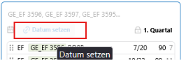

# 8. Aufgaben aus der Schulpraxis

Die folgenden Aufgaben bilden typische Änderungen im laufenden Schuljahr ab. Sie bauen auf der Planung aus den Kapiteln 1 bis 7 auf.

## Änderung der Schriftlichkeit eines Schülers

:information_source: [Doku: Leistungsdaten](https://doku.svws-nrw.de/svws-client/apps/schueler/lernabschnitte/leistungsdaten/)  
:information_source: [Doku: Laufbahnen](https://doku.svws-nrw.de/svws-client/apps/gost/laufbahn/)  
:information_source: [Doku: Fehler und Hinweise](https://doku.svws-nrw.de/svws-client/apps/gost/klausurplanung/#fehler-und-hinweise)

::: info 📝 Aufgabe 8.1 „Schriftlichkeit ändern“
Ändern Sie bei Schülern des zu planenden Jahrgangs in den **Leistungsdaten** (Kontrolle in der Laufbahnplanung):

1. eine mündliche Belegung zu einer schriftlichen,
2. eine schriftliche Belegung zu einer mündlichen.
3. Stellen Sie einen Fall nach, in dem in einem Kurs keine Klausur mehr geschrieben wird.
4. Suchen Sie einen Kurs ohne GKS-Belegung und weisen Sie einem Schüler eine schriftliche Klausurart zu.
:::

::: info 📝 Aufgabe 8.2 „Abweichungen übernehmen“
1. Prüfen Sie in der Klausurplanung unter **Fehler und Hinweise** den Abschnitt **Abweichungen**.
2. Übernehmen Sie die gefundenen Abweichungen oder setzen Sie sie ggf. wieder zurück.
:::

## Änderung eines Klausurtermins (mehrere Kurse)

::: tip Hinweis
Das Datum einer Klausur kann in **Schienen** unter **Datum setzen** geändert werden

oder direkt per Drag & Drop im **Kalender**.
:::

:information_source: [Doku: Klausurtermine im Kalender festlegen](https://doku.svws-nrw.de/svws-client/apps/gost/klausurplanung/#klausurtermine-im-kalender-festlegen)

::: info 📝 Aufgabe 8.3 „Termin verschieben“
1. Ändern Sie den Termin einer Klausur, einmal über **Datum setzen** und einmal per Drag & Drop im **Kalender**.
2. Provozieren Sie dabei auch Terminkollisionen und mehr als zwei oder drei Klausuren pro Schüler in einer Woche.
3. Werten Sie die Hinweise aus und machen Sie die Änderung wieder rückgängig.
:::

## Änderung nur eines Kurstermins

::: tip Hinweis
Eine abweichende Startzeit eines Kurses bei gleichem Datum ist kein neuer Termin. Hier kann unter **Räume und Startzeiten** eine abweichende Startzeit eingetragen werden.
:::

Um den Termin eines einzelnen Kurses, der in einem Termin mit anderen Kursen liegt, zu ändern, muss dieser in **Schienen** aus seinem bestehenden Termin entfernt werden. Je nach Planungsfortschritt erscheinen Warnmeldungen bzgl. möglicher Raumplanungen.

:information_source: [Doku: Klausurtermine blocken](https://doku.svws-nrw.de/svws-client/apps/gost/klausurplanung/#klausurtermine-blocken)  
:information_source: [Doku: Räume und Startzeiten festlegen](https://doku.svws-nrw.de/svws-client/apps/gost/klausurplanung/#raume-und-startzeiten-festlegen)

::: info 📝 Aufgabe 8.4 „Einen Kurs neu terminieren“
**Lösen** Sie einen Kurs in **Schienen** aus einem bestehenden Termin. Dann:

1. Fügen Sie den Kurs einem bereits **bestehenden Termin** kollisionsfrei hinzu (wenn möglich).
2. Alternativ: Erstellen Sie einen **neuen Termin**, fügen Sie den Kurs hinzu und setzen Sie ein neues Datum.
3. Prüfen Sie anschließend die **Raumplanung** des alten und des neuen Termins.
:::
