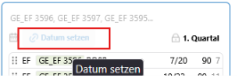

# Aufgaben aus der Schulpraxis 

## Änderung der Schriftlichkeit eines Schülers  

Ändere bei einem Schüler in den **Leistungsdaten** (Kontrolle in Laufbahnplanung) des zu planenden Jahrgangs eine  

- mündliche Belegung zu einer schriftlichen.  

- schriftliche Belegung zu einer mündlichen.  

- Stelle einen Fall nach, in dem in einem Kurs keine Klausur mehr geschrieben wird.  

- Suche einen Kurs ohne GKS-Belegung und weisen sie einem Schüler eine schriftliche Klausurart zu.

Prüfe in der Klausurplanung in **Fehler und Hinweise** die Abschnitte **Abweichungen**

Übernimm die gefundenen Abweichungen oder setze sie ggf. wieder zurück.

 
   
    
  

## Änderung eines Klausurtermines (mehrere Kurse)  

>Hinweis: Das Datum einer Klausur kann in **Schienen** unter **Datum setzen**  
 
 oder direkt per Drag&Drop in **Kalender**

Ändere den Termin einer Klausur.

Provoziere dabei auch Terminkollisionen und mehr als zwei oder drei Klausuren pro Schüler in einer Woche.

## Änderung nur eines Kurstermines 

>Hinweis: Eine abweichende Startzeit eines Kurses bei gleichem Datum ist kein neuer Termin. Hier kann eine abweichende Startzeit eingetragen werden.

Um den Termin eines einzelnen Kurses, der in einem Termin mit anderen Kursen liegt, zu ändern, muss dieser in **Schienen** aus seinem bestehenden Termin entfernt werden. Je nach Planungsfortschritt erscheinen Warnmeldungen bzgl. mgl. Raumplanungen.  

**Löse** einen Kurs aus einem bestehenden Termin.  
  
  1. Füge den Kurs einem bereits **bestehenden Termin** kollosionsfrei hinzu (wenn möglich)
    
  2. Erstelle einen **neuen Termin**, fügen den Kurs zu und setzen ein neues Datum.
