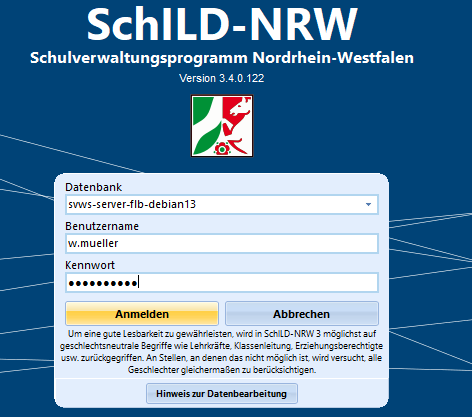
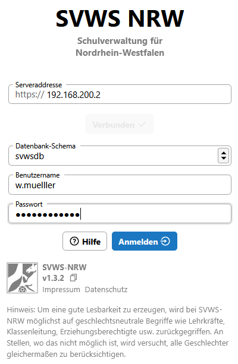

# 1. Orientierung in der neuen Version der Schulverwaltsungssoftware

## Einführung

> [!TIP] Moderationshinweis
> * Wie öffnet man den SchILD3-Client?
> * Wofür dient das Arbeitsverzeichnis (Verweis auf Reports, Exporte, Sicherungsordner)?

:a: **Aufgaben 0.1 "Schüler sichten mit SchILD3"**
+ Öffne SchILD3 und wähle eine Datenbank aus.
  
+ Sichte einige Schüler in SchILD3 und pflege folgende Änderungen ein:
    1. Ein Schüler aus einer Klasse (bitte selbst wählen) hat Religion abgewählt. Trage dieses bitte ein.
    2. Bei einem Schüler fehlt der Migrationshintergrund. Trage diesen bitte nach.   
       Hinweis: Die Einstellung "vereinfachter Migrationshintergrund" wurde abgeschafft. Fülle alle für die Statistik relevanten Felder. Diese sind mit * gekennzeichnet.
    3. Füge bei einem Schüler einen Vermerk mit heutigem Datum hinzu.
    4. Nur relevant für weiterführende Schulen: Sichte den Reiter Laufbahninfo. Trage für einen Schüler aus dem Abschlussjahrgang (z.B. aus der Q2 am Gymnasium)  die Sprache Spanisch (oder eine andere Sprache) in der Sprachenfolge nach. Ergänze ebenfalls für einen Schüler den Herkunftssprachlichen Unterricht "Polnisch".
    
:a: **Aufgaben 0.1 "Schüler sichten mit dem SVWS-Client"**
+ Öffne mit dem Browser die Website des SVWS-Client (z.B. direkt über die IP-Adresse des Servers als URL in der Adresszeile)
+ Melde Dich mit Deinem Benutzer an.
  
+ Sichte einige Schüler. Gehe hierzu oben links in den Suchfilter für Schüler. Gib geeignete Suchkriterien ein und wähle einzelne Schüler aus.
+ Ändere analog zu o.g. Schritten die Eintragungen bei den ausgewählten Schülern.