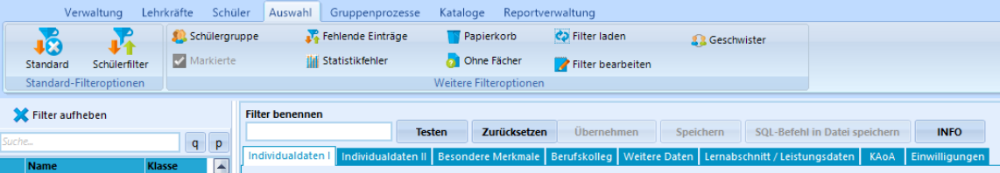
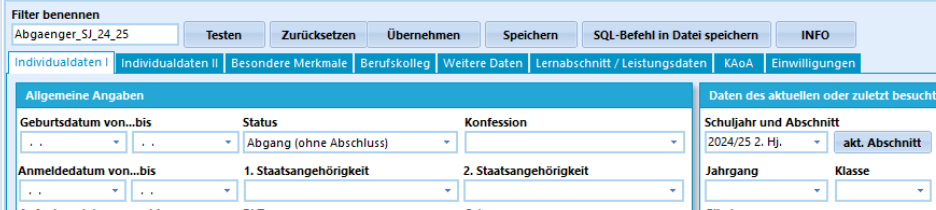
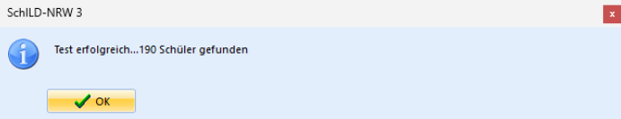
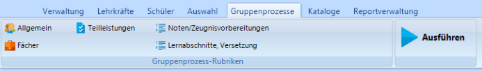
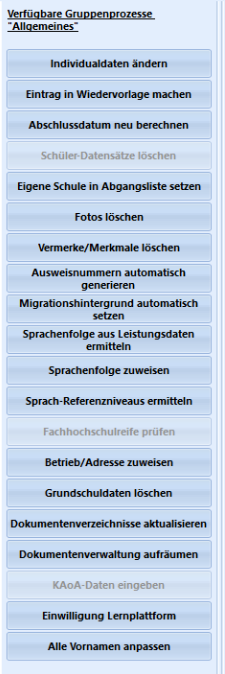
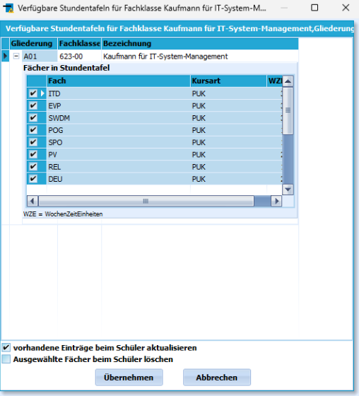
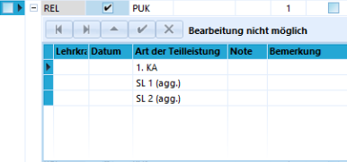

# 2. Filtern & Gruppenprozesse

## Filtern

> [!TIP] Moderationshinweis
> * Wozu benötige ich in SchILD3 Filter ?
> * Wie lege ich neue Filter an, die ich später schnell wieder aufrufen kann?

:a: **Aufgabe 2.1 "Schüler nach Merkmalen filtern"**
+ Öffne SchILD3 und wähle eine Datenbank aus.
+ Klicke in SchILD3 auf "Auswahl". 
  

+ Definiere nun einen neuen Filter mit dem Namen "Abgaenger_SJ_2025_26":
    1. Trage unter "Filter benennen" einen Filternamen ein.
    2. Wähle unter "Individualdaten I" als "Status" "Abgang (ohne Abschluss)" aus.    
    3. Wähle in den "Abschnittsdaten" als "Schuljahr und Abschnitt" den Wert "2025/26 2 HJ." aus.
    4. Klicke danach den Button "Testen".
       

    5. Es wird die ermittelte Schüleranzahl ausgegeben, die auf die UND-verknüpften Suchkriterien passen.
       

    6. Klicke nun den Button "Übernehmen", um mit den gefilterten Daten weiterzuarbeiten.

    
:a: **Aufgabe 2.2 "Speichere den getesteten Filter"**
+ Gehe wie in 2.1 beschrieben vor und speichere Deinen Filter in sinnvoller Form für Deine Schule.
+ Vergib einen eindeutigen Namen und eine für Deine Schule hilfreiche Beschreibung.
+ Welche zusätzlichen Schritte sind erforderlich?
+ Was ist zu beachten, um nur getestete Filter dauerhaft zu speichern?

:a: **Aufgabe 2.3 "Speichere weitere Filter"**
+ Gehe wie in 2.1 beschrieben vor und erweitere Deine Filter. Wähle hierzu mehrere Beispiele aus Deiner Schule aus. 
+ Speichere Deine Filter.

:a: **Aufgabe 2.4 "Lade und verändere Deine Filter"**
+ Klicke in SchILD3 auf "Auswahl".
+ Lade einen Deiner Filter und wende diesen an.
+ Erweitere danach die Filterkriterien und speichere den Filter unter einem neuen Namen ab.
+ Welche Schritte sind erforderlich?

## Gruppenprozesse

> [!TIP] Moderationshinweis
> * Wozu sind welche Gruppenprozesse (GP) vorgesehen?
> * Welche GPs sollten im Sekretariat, bei der Zeugnisschreibung sowie Schulleitung geläufig sein?

:a: **Aufgabe 2.5 "Erste Gruppenprozesse anwenden"**
+ Öffne SchILD3 und wähle eine Datenbank aus.
+ Wähle links über "Aktuelle Schülerauswahl" eine Klasse aus.
+ Klicke danach in SchILD3 auf "Gruppenprozesse". 
  

+ Es öffnet sich darunter ein Kontextmenü, in dem verfügbare Gruppenprozesse aufgelistet werden:

  Dies sind die Gruppenprozesse aus dem Anwendungsbereich "Allgemeines":
  

+ Für die Bereiche "Fächer, Teilleistungen, Noten/Zeugnisvorbereitung und Lernabschnitte/Versetzung u.a." gibt es weitere GP.
+ Wähle einen Gruppenprozess aus, um diesen auf die Auswahlmenge an Schülern (also z.B. die ausgewählte Klasse) anzuwenden.
+ Wähle als GP unter "Allgemeines" - "Individualdaten ändern". 
+ Setze für die Schüler der Klasse die "Aktuellen Laufbahndaten" neu.
+ Führe den GP mit dem Button "Ausführen" aus. 
+ Kontrolliere bei den einzelnen Schülern der Klasse, ob die Änderungen übernommen wurden.

:a: **Aufgabe 2.6 "Stundentafel den Schülern einer Klasse zuweisen"**
> [!TIP] Stundentafeln müssen zuvor unter "Kataloge" - "Stundentafeln" festgelegt worden sein.

+ Weise nun eine bereits definierte Stundentafel allen Schülern einer Klasse zu.
+ Wähle links über "Aktuelle Schülerauswahl" eine Klasse aus.
+ Es wird gemäß der bei den Schülern eingetragenen Gliederung und Fachklasse eine verfügbare Stundentafel zur Auswahl dargestellt.
  
+ Wähle danach das Halbjahr aus, in dem die Stundentafel zugeordnet werden soll (z.B. Schuljahr: 2025/26 2. HJ.).
+ Kontrolliere das Ergebnis unter "Schüler" - "Aktuelle Schülerauswahl: Klasse" - "Halbjahr auswählen" - "Akt. Halbjahr" - "Leistungsdaten".
  
+ Klicke vor dem jeweiligen Fach auf das Plus-Zeichen (+), so werden die zugeordneten Teilleistungskategorien aufgeklappt.
+ Prüfe, ob für alle Fächer die Teilleistungskategorien bei den Schülern in der Klasse angelegt wurden.
+ Falls dies nicht der Fall sein sollte: Welchen Gruppenprozess müsstest Du hierfür nutzen? Führe dies durch.

:a: **Aufgabe 2.7 "GPs entdecken"**
+ Wähle links über "Aktuelle Schülerauswahl" eine Klasse aus.
+ Teste mit dieser verschiedene Gruppenprozesse aus den Bereichen "Allgemein", "Fächer","Teilleistungen" aus. 
+ Welche Nutzergruppe sollte mit welchem Prozess vertraut sein?

