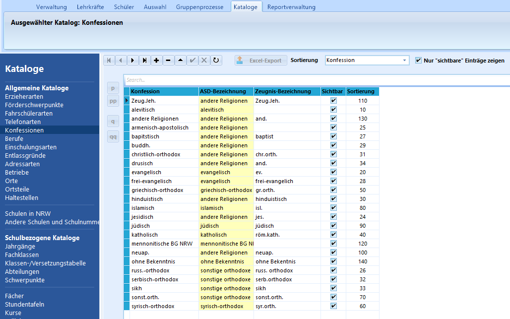
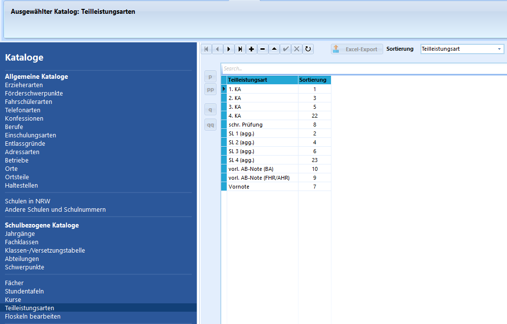
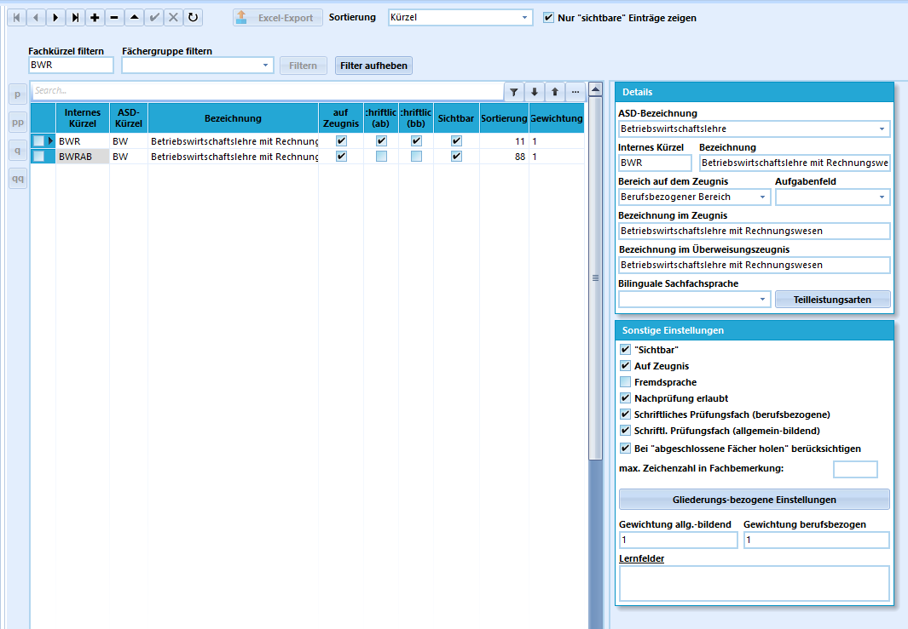
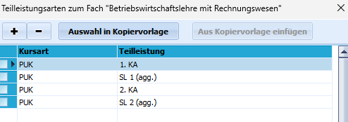
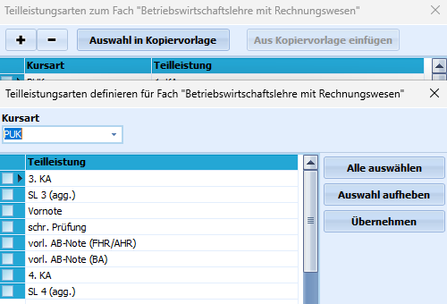

# 3. Kataloge

## Allgemeine Kataloge 

> [!TIP] Moderationshinweis
> * Wann nutze ich Kataloge ?
> * Wie kann ich fehlende Eintragungen in den Katalogen ergänzen?

:a: **Aufgabe 3.1 "Allgemeine Katalogen erkunden: Konfessionen"**
+ Öffne SchILD3 und wähle eine Datenbank aus.
+ Klicke in SchILD3 auf "Kataloge" und dann links unter "Allgemeine Kataloge" den Eintrag "Konfessionen". 
  

+ Orientierung:
    1. Der schware Pfeil vor der jeweiligen Konfessionszeile zeigt den aktuell ausgewählten Datensatz an.
    2. Deaktiviere nun für diejenigen Religionen, die bisher an Deiner Schule Schülern nicht zugewiesen wurden, die Sichtbarkeit.
       Hierzu klicke auf den Haken in der Spalte sichtbar, so dass dieser entfernt wird. 

    3. Oben rechts hast Du ausgewählt, dass nur sichtbare Einträge angezeigt werden sollen. Du musst nun 
       den Button mit dem Pfeil mit der Spitze im Uhrzeigersinn klicken, um den Datenbestand neu zu laden.

    4. Es müsste nun eine Konfession weniger angezeigt werden. Zugleich wird bei den Schülern in den "Individualdaten I" die Auswahlliste für die "Konfession" 
       entsprechend verkürzt.

    5. Sollte diese später wieder benötigt werden, deaktiviere oben den Haken bei "Nur "sichtbare" Einträge anzeigen" und
       aktivieren wieder den Haken in der Spalte "Sichtbar".

    6. Möchtest Du die Anzeige nicht nach der Spalte "Konfession" aufsteigend sortiert darstellen lassen,
       kannst Du in der Spalte Sortierung Zahlen eintragen. Es wird dann von den kleinsten zu den größten Zahlen sortiert, wenn 
       Du oben unter "Sortierung: Benutzerdefiniert" auswählst. 
       
    7. Du kannst so z.B. eine Sortierung erreichen, die zuerst die besonders häufig auszuwählenden Konfessionen voranstellt und andere 
       danach darstellt. Dies spiegelt sich auch bei den Schülerdaten unter "Individualdaten I" in der Auswahlliste "Konfession" wieder.

    
:a: **Aufgabe 3.2 "Ergänze fehlende Ortsteile"**
+ Gehe wie in 3.1 beschrieben vor und wähle den Katalog Ortsteile aus.
+ Gehe nun auf das Plus-Zeichen, um einen neuen Datensatz zu ergänzen.
+ Trage nun z.B. Morenhoven mit der Postleitzahl 53919 ein.
+ Ortsteile werden benötigt, wenn bei Schüleradressen eine Gemeinde mehrere Ortschaften ausweist.
+ In den Schülerdaten bei den "Individualdaten I" findet sich unterhalb des Datenfeldes "Ort" das Datenfeld "Ortsteil".
+ In Reports sollte darauf geachtet werden, dass dieses Datenfeld für die Adresse mit ausgegeben wird.

> [!TIP] Ergänzung von Katalogen
> * Sollte es erforderlich sein, in den Schulkatalogen einzelne Schulen nachzutragen, suche unbedingt vorher nach den korrekten Schulnummern:
    https://www.schulministerium.nrw.de/BiPo/SchuleSuchen/ 
> * Bei den Katalogen gilt es, bei Ergänzungen die Schlüsseltabellen der jeweiligen Schulform für die Statistik zu beachten: https://schulverwaltungsprogramme.msb.nrw.de/schulen/download.htm#D89

# Schulbezogene Kataloge 

> [!INFO] Moderationshinweis
> * Welche Kataloge benötigt unsere Schule regelmäßig?
> * Wann müssen hier Eintragungen ergänzt werden?

:a: **Aufgabe 3.3 "Schulbezogene Katalogen"**
+ Öffne SchILD3 und wähle eine Datenbank aus.
+ Klicke in SchILD3 auf "Kataloge" und dann links unter "Schulbezogene Kataloge" den Eintrag "Teilleistungsarten". 
  

+ Ergänze alle Teilleistungsarten, die an Deiner Schule genutzt werden müssen.
+ Prüfe, wann welche Teilleistungsart an Deiner Schule in welchen Fächern und Bildungsgängen einzusetzen ist.

:a: **Aufgabe 3.4 "Teilleistungsarten bei Fächern ergänzen"**
+ Gehe unter "Kataloge" - "Schulbezogene Kataloge" - auf "Fächer".
+ Wähle ein Fach über "Fachkürzel filtern" aus.
  
+ Klicke rechts in den Details des ausgewählten Faches auf den Button "Teilleistungsarten".
  
+ Ergänze über das Plus-Zeichen weitere Teilleistungsarten. Wähle zunächst die Kursart aus, bei vielen Fächern ist dies PUK (Unterricht im Klassenverband).
+ Es werden Dir weitere Teilleistungsarten aus dem Katalog angezeigt, die Du noch dem Fach als Vorlage zuordnen kannst.
  
+ Setze vor denjenigen Teilleistungen einen Haken, die Du dem Fach zusätzlich zuordnen möchtest. Klicke dann auf "Übernehmen".
+ Kontrolliere die Eintragungen, indem Du bei dem Fach erneut auf die Teilleistungsarten klicken. Es sollten nun alle erforderlichen TL angezeigt werden.

:a: **Aufgabe 3.5 "Teilleistungsarten bei Fächern ergänzen"**
+ Wähle "Schüler" aus und tragen dort unter "Aktuelle Schülerauswahl" eine Klasse Deiner Wahl ein.
+ Klicke nun auf "Gruppenprozesse" und suche nach dem geeigneten Gruppenprozess, um die im Fach als Vorlage zugeordneten Teilleistungsarten, 
  den Schülern einer Klasse in den Leistungsdaten zuzuordnen. 
+ Welcher GP ist dies und wie ist dieser anzuwenden?
+ Wie kannst Du kontrollieren, ob die Teilleistungsarten in den Fächern den Schülern wirklich zugeordnet wurden?

