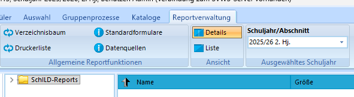
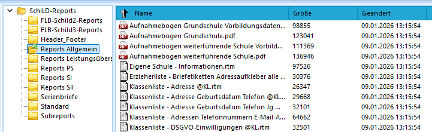
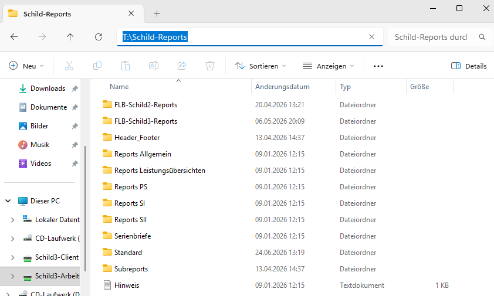
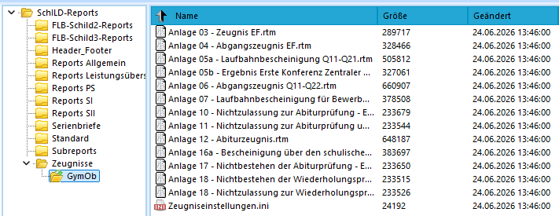
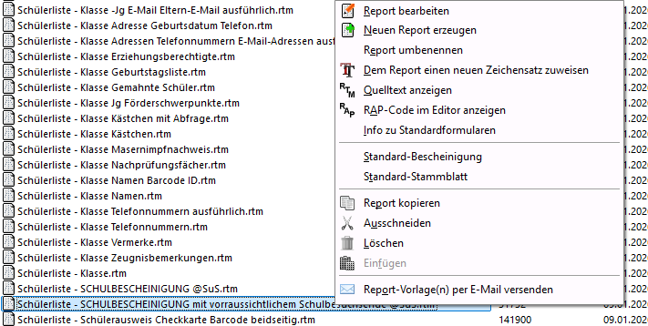

# 4. Reports

> [!TIP] Moderationshinweis
> * Wo liegen die Reports?
> * Wie kann ich die Stuktur der bereitgestellten Reports anpassen?
> * Welche Einstellungen kann ich anpassen?
> * Wie nutze ich bestehende Reports?

:a: **Aufgabe 4.1 "Finde heraus, welche Reports bei Dir bereits genutzt werden können."**
+ Öffne SchILD3 und wähle eine Datenbank aus.
+ Klicke in SchILD3 auf "Reportverwaltung" und erweitere den Verzeichnisbaum unterhalb des Ordners "Schild-Reports".
  
+ Welche Reports werden in Deiner Schule bereits für SchILD3 zur Verfügung gestellt? 
  

:a: **Aufgabe 4.2 "Erweitere die Ordnerstruktur Deiner Reports."**
+ Öffne das Netzlaufwerk oder den lokalen Ordner "SVWS-Arbeitsverzeichnis" mit dem Datei-Explorer.
  
+ Lege im Verzeichnis "Schild-Reports" ein neues Unterverzeichnis "Zeugnisse" an.
+ Lade hier (https://www.svws.nrw.de/svws-server-schild-nrw-3/reports-zeugnisse-fuer-schild-nrw-3-als-download) die bereitgestellten Zeugnis-Reports für Schild3 für Deine Schulform herunter. Entpacke diese in das neu angelegte Verzeichnis.
+ Klicke nun in SchILD3 in der "Reportverwaltung" auf "Verzeichnisbaum", damit dieser neu eingelesen wird, erweitere wieder die Ansicht auf die Unterordner.
+ Prüfe, welche Zeugnis-Reports Dir nun zur Verfügung stehen. Klicke hierzu auf den Ordner "Zeugnisse" unterhalb der "Schild-Reports".
  

:a: **Aufgabe 4.3 "Lege Standard-Reports fest."**
+ Öffne SchILD3 und wähle eine Datenbank aus.
+ Klicke in SchILD3 auf "Reportverwaltung" und erweitere den Verzeichnisbaum unterhalb des Ordners "Schild-Reports".
+ Suche Dir nun einen geeigneten Report für den Druck des Schüler-Stammblattes sowie der Schulbescheinigung aus (z.B. im Ordner "Reports Allgemein").
+ Markiere den Report, den Du für das Schüler-Stammblatt verwenden willst. Klicke nun mit der rechten Maustaste und wähle aus dem Kontextmenü "Standard-Stammblatt".
+ Markiere den Report, den Du für die Schulbescheinigung verwenden willst. Klicke nun mit der rechten Maustaste und wähle aus dem Kontextmenü "Standard-Bescheinigung".
  

> [!TIP] Anpassung der Standard-Reports bei einer migrierten Datenbank
> * Hast Du zuvor SchILD2 genutzt und Deine Datenbank wurde für den SVWS-Server migriert, musst Du ggf. die Pfade für die Standard-Formulare einmal zurücksetzen, bevor Du diese neu setzen kannst.
> * Gehe hierzu in SchILD3 auf "Verwaltung", dann auf "Einstellungen" - "Individuelle Einstellungen". Dort gibt es eine Rubrik "Andere" mit dem Eintrag "Individuelle Einstellungen zurücksetzen". Klicke diesen Button, beende SchILD3 und starte das Programm neu. Danach setze, wie zuvor beschrieben die Standard-Reports, erneut fest.

:a: **Aufgabe 4.4 "Drucke eine Schulbescheinigung aus."**
+ Öffne SchILD3 und wähle eine Datenbank aus.
+ Wähle in SchILD3 unter "aktuelle Schülerauswahl" einen Schüler aus einer Klasse aus. Klicke nun oben rechts auf Schulbescheinigung.
+ Lass Dir die Schulbescheinigung für den aktuell ausgewählten Schüler anzeigen.

